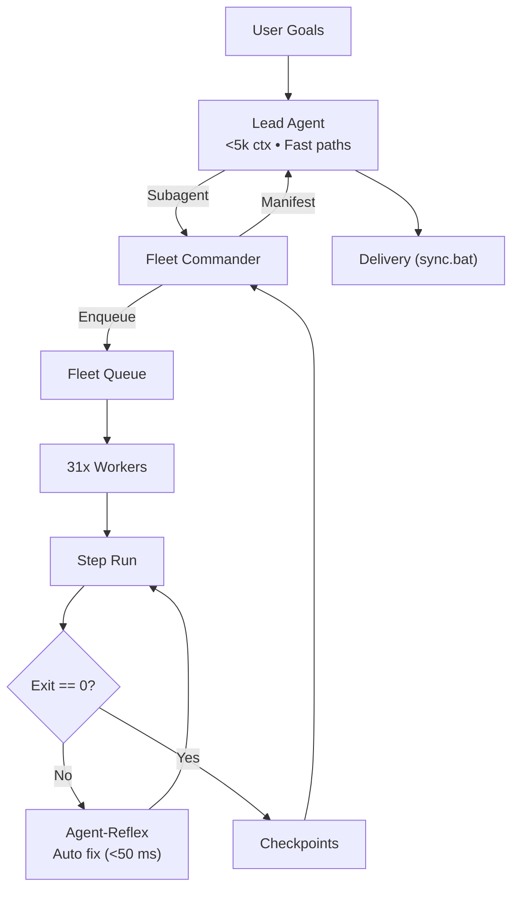

# Adaptive Workflow Orchestrator (`adaptive-workflow`)

Universal meta-orchestrator for Aaradhya's ecosystem (28 modules, 35 branches). Enforces context firebreak (`INV-CTX-FIREBREAK`), CPM DAGs (`INV-CPM-SOLVER`), 31-worker Copilot pool (`INV-ASYM-FLEET`), 30 Gemini keys, Azmuth Foresight (`U0`–`U5`), Colab accelerators, 9 archetypes, real-time grounding & zero-help loops.

---

## 1. Command Hierarchy & Context Firebreak



### Hierarchy Responsibilities:
1. **Lead Agent**: Triage via `adaptive_engine.py`. Tier 0 fast paths. Solves CPM. Context $<5\text{k}$ tokens (`INV-CTX-FIREBREAK`).
2. **Domain Commanders**: Writes tasks to `orchestrator-state/tasks/`. Returns **<300w manifest** to Lead.
3. **Headless Workers & Cloud**: 31 accounts in `.worktrees/<task_id>` + `ColabCloudAdapter` (zero local `.ipynb`).
4. **Agent-Reflex**: Intercepts tool errors at port 1234 for sub-second recovery (`INV-AGENT-REFLEX`).
5. **Azmuth Neuromorphic Core & Daemon**: 20W spiking macro-graph engine (`azmuth_macro_graph.py`) across 6 Cartridges (`U0`–`U5`), live sensors, 4-stream GitHub radar (`azmuth_github_sensor.py`), CBF brake, idle-burst daemon with dynamic speed gears (`Whisper`/`Balanced`/`Turbo` via `tools/azmuth_daemon.py`), native Windows System Tray Controller (`tools/azmuth_tray.py` / `launch_azmuth_tray.bat`), and 60FPS High-DPI Command Center GUI (`tools/azmuth_gui.py` / `launch_azmuth_gui.bat`).

Protocols: [`references/fleet-command-architecture.md`](references/fleet-command-architecture.md).

---

## 2. Multi-Tier Execution Hierarchy & Fast Paths

| Tier | Workload | Backend | Cost | Latency / RAM |
| :--- | :--- | :--- | :--- | :--- |
| **Tier 0** | Routine: `audit.bat`, `sync.bat`, CP replica, thesis, tests | Shell / Python | **$0.00** | **<20 ms** / **<10 MB** |
| **Tier 0-Bio**| Azmuth Foresight & GitHub Radar (`U0`–`U5`), Live Sensors | `azmuth_macro_graph.py` | **$0.00** | **<50 ms** / **<15 MB** |
| **Tier 1A** | Intent triage, time allocation, matrix routing | `fleet-master-3b` / `qwen-router` | **$0.00** | **30-50 ms** / **380MB–1.8GB** |
| **Tier 1B** | Agent-Reflex self-healing & action prefetch | `fleet-master-3b` (port 1234) | **$0.00** | **<50 ms** / **~1.8 GB** |
| **Tier 1C** | Multi-file coding, batch tasks, test generation | `Fleet-Orchestrator` (31 workers, REA) | **$0.00** | Cloud / **<30 MB** |
| **Tier 1D** | Deep refactoring, test fixes, invariant audits | `fleet-master-7b` ($\ge 8\text{GB}$ RAM) | **$0.00** | **300-800 ms** / **~4.36 GB** |
| **Tier 1E** | Cloud GPU/TPU training, CUDA, remote `.ipynb` | `colab-cloud-accelerator` | Compute units | Cloud VM / **0 MB** |
| **Tier 2** | Interactive conversational reasoning | Gemini 3.8 Flash / Lite (30-key pool) | **<$0.001** | Sub-second / **0 MB** |
| **Tier 3** | Complex deadlocks after test failure | Claude Opus, Gemini Pro | Standard API | Gated on failure |

Fast paths: [`references/deterministic-zero-ai-protocol.md`](references/deterministic-zero-ai-protocol.md) | Models: [`references/fleet-master-brain-models.md`](references/fleet-master-brain-models.md).

---

## 3. Mathematical CPM Concurrency

Dates, critical paths, and slacks are solved in `tools/cpm_solver.py` with zero prompt arithmetic (`INV-CPM-SOLVER`):

```powershell
python tools/adaptive_engine.py cpm --dag-json path/to/dag.json
```

- **Dates**: $ES_j = \max_{i \in Pred(j)} EF_i, EF_j = ES_j + D_j$; $LF_i = \min_{j \in Succ(i)} LS_j, LS_i = LF_i - D_i$.
- **Slacks**: $TS_i = LF_i - EF_i$; $FS_i = \min_{j \in Succ(i)} ES_j - EF_i$. Critical Path: $TS = 0$.

Mechanics: [`references/cpm-concurrency-dispatch.md`](references/cpm-concurrency-dispatch.md).

---

## 4. 2D Orthogonal Execution Matrix

Decouples Workload Volume ($V0 \le 2$, $V1 = 3\text{–}15$, $V2 > 15$ files) from Blast Criticality ($R0 \le 0.10$, $R1 = 0.10\text{–}0.35$, $R2 > 0.35$):

$$C = \min\left(1.0, \max\left(0.0, \frac{2|D| + |T_{\text{ind}}|}{2(N - 1)}\right)\right), \quad N = 28$$

```powershell
python tools/adaptive_engine.py triage "refactor router" -f sim/routing_engine.py -j
```

| Cell | Policy | Mechanism | Concurrency |
| :--- | :--- | :--- | :--- |
| **(V0, R0)** | `DIRECT_FAST` | In-turn or Tier 0 fast path | In-turn |
| **(V0, R1)** | `BRANCH_GUARD` | Isolated branch with test gate | 1 subagent |
| **(V0, R2)** | `SURGICAL_LOCK` | Sequential edit with git snapshots | Sequential |
| **(V1, R0)** | `CONCURRENT_LOCAL` | Parallel edits; pre/post SHA-256 | Up to 4 |
| **(V1, R1)** | `STAR_SUBAGENTS` | Disjoint subagents on scratch files | 3 subagents |
| **(V1, R2)** | `DECOUPLED_SLICES` | Micro-PR branches (`split-to-prs`) | Sequential |
| **(V2, R0)** | `FLEET_SWARM` | Fleet-Orchestrator cloud pool | Up to 31 |
| **(V2, R1)** | `THROTTLED_FLEET` | Batched sub-PR slices via Fleet | Throttled |
| **(V2, R2)** | `STRICT_INTERLOCK` | Halted; requires confirmation | Blocked |

Matrix reference: [`references/orthogonal-execution-matrix.md`](references/orthogonal-execution-matrix.md).

---

## 5. Memory Guard & Flight Envelope

Enforces Antigravity IDE stability and Banker's safety:
- **Reserve Floor**: $2,048\text{ MB}$ permanently reserved for IDE. Concurrency: $\lfloor (\text{Free RAM} - 2048) / 256 \rfloor$.
- **Rate Governor**: Targets $L_{\text{target}} = 1200\text{ms}$. On $\ge 2$ 429s in 60s, $M$ halved to $\max(0.25, M/2)$ (120s window).

Envelope reference: [`references/dynamic-flight-envelope.md`](references/dynamic-flight-envelope.md).

---

## 6. CLI Syntax Contract Table (`INV-ZERO-HELP-LOOP`)

| Task Goal | CLI Command | Output | Latency |
| :--- | :--- | :--- | :--- |
| **Triage** | `python tools/adaptive_engine.py "<prompt>" -j` | Decision JSON | <20ms |
| **File Triage** | `python tools/adaptive_engine.py "<prompt>" -f <paths> -j` | Decision JSON | <20ms |
| **Grounded Triage** | `python tools/adaptive_engine.py "<prompt>" -g -j` | Grounded JSON | <50ms |
| **CPM Schedule** | `python tools/adaptive_engine.py cpm --dag-json <path>` | Schedule JSON | <30ms |
| **Schema Contract** | `python tools/adaptive_engine.py --schema` | JSON Schema | <5ms |

---

## 7. Supporting References & Verification

- [`references/token-budget-and-scalability-governance.md`](references/token-budget-and-scalability-governance.md): Token governance.
- [`references/skill-matrix.md`](references/skill-matrix.md): 9-archetype routing matrix.
- [`references/installed-work-tools-catalog.md`](references/installed-work-tools-catalog.md): Workstation catalog.
- [`references/agent-reflex-and-tool-speculator.md`](references/agent-reflex-and-tool-speculator.md): Agent-Reflex & Speculator.
- [`references/fleet-master-brain-models.md`](references/fleet-master-brain-models.md): Dual-model (3B/7B), A100.
- [`references/historical-provenance.md`](references/historical-provenance.md): Baseline lock & 22 invariants.
- [`references/verification-gates.md`](references/verification-gates.md): Verification sequence (`INV-AUDIT-ORDER`).
- [`references/worker-availability-ledger.md`](references/worker-availability-ledger.md): Worker state table.
- [`references/quota-velocity-acceleration.md`](references/quota-velocity-acceleration.md): Credit acceleration.
- [`references/transactional-recovery.md`](references/transactional-recovery.md): Fencing tokens & projection restore.
- [`references/ecosystem-repos.md`](references/ecosystem-repos.md): Catalog of 28 registered tools.
- [`examples/routing-scenarios.md`](examples/routing-scenarios.md): Archetype walkthroughs.

