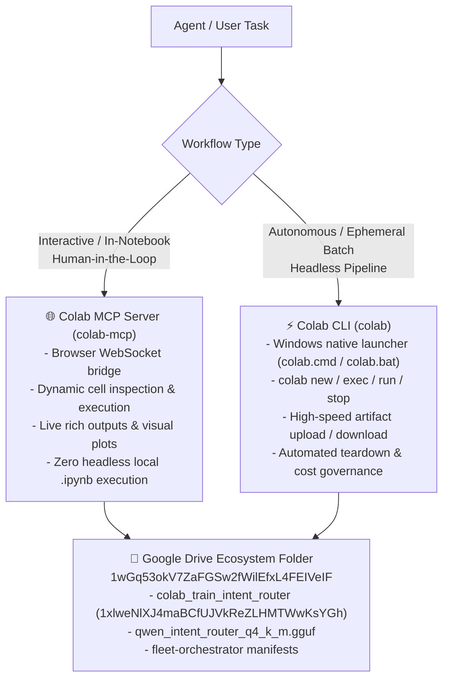
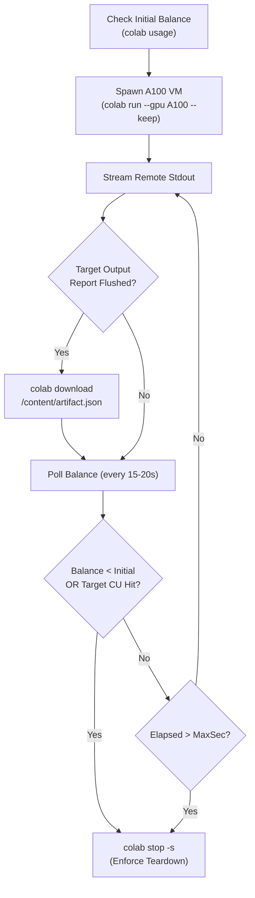

# Google Colab Cloud Accelerator (`colab-cloud-accelerator`)

This skill defines the authoritative architecture, protocols, and workflows for executing remote compute, training machine learning models, and interacting with Google Colab runtimes across Aaradhya's developer ecosystem.

---

## 1. Architectural Philosophy: The Dual Colab Gateway

Google Colab provides high-performance cloud compute (NVIDIA T4, L4, A100, and Google TPU v5e/v6e) without local hardware constraints or memory exhaustion. The ecosystem provides two complementary interfaces:



### Core Invariant
> **Jupyter Notebook Invariant**: *Never run or execute `.ipynb` files headlessly via local CLI commands; leave execution for Google Colab or manual runs.*
> Both `colab-mcp` and `colab` CLI uphold this invariant by running execution remotely on Google's cloud infrastructure.

---

## 2. Interface 1: Interactive Browser Workflows (`colab-mcp`)

The official Google Colab MCP server bridges local agents (Antigravity, Gemini CLI, Claude Code) to interactive sessions in the browser.

### MCP Configuration
Registered in `~/.gemini/antigravity/mcp_config.json`:
```json
"colab-mcp": {
  "command": "uvx",
  "args": ["git+https://github.com/googlecolab/colab-mcp"]
}
```

### Protocol & Lifecycle
1. **Initial Tool**: Call `open_colab_browser_connection` via `call_mcp_tool`.
2. **WebSocket Bridge**: The server spins up an ephemeral WebSocket server with an authentication token and opens Google Colab in the user's default browser.
3. **Targeting an Existing Notebook**: When working on an existing tracked notebook (such as `colab_train_intent_router`):
   ```
   https://colab.research.google.com/drive/1xlweNlXJ4maBCfUJVkReZLHMTWwKsYGh#mcpProxyToken=<token>&mcpProxyPort=<port>
   ```
4. **Dynamic Tool Injection**: Once the browser connects, Colab dynamically injects live tools (`notifications/tools/list_changed`):
   - Cell inspection and editing
   - Remote code execution on selected hardware (CPU/GPU/TPU)
   - Streamed stdout, stderr, and rich display evaluation

---

## 3. Interface 2: Autonomous Headless Pipelines (`colab` CLI)

The Google Colab CLI provides programmatic, terminal-based control over remote Colab VMs.

### Windows Native Support
On Windows, `colab.exe` is launched via the zero-friction wrapper (`colab` / `colab.bat` / `C:\Users\Aaradhya\.local\bin\colab.cmd` wrapping `tools/colab_cli_win.py`), which dynamically stubs Unix-only `termios`/`tty` console imports.

### Essential Commands

#### 1. Ephemeral One-Shot Jobs (`colab run`)
Provisions a VM, executes the script, downloads outputs, and automatically destroys the VM upon completion:
```powershell
colab run --gpu T4 script.py [args...]
colab run --gpu L4 --high-mem finetune_pipeline.py
```
- Exit codes propagate directly from the remote script to the local shell.
- Diagnostic logs go to stderr; script output goes to stdout.

#### 2. Persistent Multi-Step Sessions
When building up kernel state incrementally:
```powershell
# 1. Allocate session (Always pass -s <name>)
colab new -s router-forge --gpu L4

# 2. Install dependencies via uv inside VM (NEVER install xformers — uses native FlashAttention-2 / SDPA)
colab install -s router-forge unsloth peft bitsandbytes "trl<0.9.0"

# 3. Execute remote script
colab exec -s router-forge -f train_router.py

# 4. Download generated model / artifact
colab download -s router-forge /content/model.gguf ./models/model.gguf

# 5. Export execution log as standard notebook
colab log -s router-forge -o training_log.ipynb

# 6. Safety Teardown (Mandatory)
colab stop -s router-forge
```

#### 3. Attach Browser to Active CLI Session
Open the browser directly into an active CLI VM:
```powershell
colab url -s router-forge --open
```

---

## 4. Tracked Ecosystem Notebooks & Drive Integration

### The Router Forge Notebook (`colab_train_intent_router`)
- **Direct Colab URL**: [colab_train_intent_router](https://colab.research.google.com/drive/1xlweNlXJ4maBCfUJVkReZLHMTWwKsYGh)
- **Google Drive Permanent ID**: `1xlweNlXJ4maBCfUJVkReZLHMTWwKsYGh`
- **Parent Folder**: `Super-NLM / Fleet-Orchestrator` (`1wGq53okV7ZaFGSw2fWilEfxL4FEIVeIF`)
- **Local Mirror**: `notebooks/slm_time_router_forge.ipynb`
- **Tracked Manifest**: `drive-manifest.json`

### Training Workflow for Intent & Skill Router
1. **Model**: `unsloth/Qwen2.5-0.5B-Instruct-bnb-4bit`
2. **Dataset**: `intent_routing_train.jsonl` + `task_time_train.jsonl`
3. **Target Runtime**: Colab Pro **L4 GPU** (24GB VRAM) or Free **T4 GPU**
4. **Output Weights**: `q4_k_m` GGUF (~380 MB)
5. **Local Deployment**: LM Studio server at `localhost:1234` managed via `fast_intent_router.py`.

---

## 5. Cost & Resource Safety Rules

1. **Mandatory Teardown**: Always execute `colab stop -s <name>` or use `colab run` (which self-cleans) to prevent unattended compute unit burn.
2. **Session Name Invariant**: Always provide explicit `-s <name>` on `colab new` to prevent ambiguous random hex session IDs.
3. **No Interactive TTY in Headless Agents**: Never invoke `colab repl`, `colab console`, `colab auth`, or `colab drivemount` in non-interactive agent turns as they require a raw TTY.
4. **Programmatic Notebook Auto-Teardown & FUSE Flush Invariant (`INV-COLAB-FUSE-FLUSH`)**:
   All autonomous Colab training notebooks must enforce a strict two-stage teardown. Writing to `/content/drive/MyDrive/...` occurs via a Linux user-space FUSE filesystem (`google.colab.drive`). Calling `runtime.unassign()` immediately after `shutil.copy2()` or `file.write()` destroys the container before dirty FUSE write buffers sync to Google Drive servers, causing missing or 0-byte files on Google Drive even when local execution output reports success.
   **Mandatory Persistence & Teardown Cell Pattern**:
   ```python
   # 1. Copy artifact to Google Drive FUSE mount
   import shutil, os, time
   src = '/content/hyperburst_results.json'
   dst = '/content/drive/MyDrive/Super-NLM/Fleet-Orchestrator/orchestrator-state/hyperburst_results_v2.json'
   if os.path.exists(src):
       shutil.copy2(src, dst)
       print(f'[SUCCESS] Written {os.path.getsize(dst):,} bytes to {dst}')

   # 2. Mandatory FUSE buffer flush & unmount BEFORE container destruction
   from google.colab import drive
   try:
       drive.flush_and_unmount()
       print('[PERSISTENCE] Google Drive FUSE cache successfully flushed.')
   except Exception as e:
       print(f'[WARNING] Drive flush encountered: {e}')
   time.sleep(2)

   # 3. Clean cloud VM teardown to cut idle compute unit burn
   from google.colab import runtime
   print('Shutting down runtime to protect compute units...')
   runtime.unassign()
   ```
5. **Dynamic Cell Appending & FIFO Execution Queue Safety**: Appending, editing, or creating new cells (such as appending a teardown cell `runtime.unassign()`) while an earlier cell is actively executing has **zero effect** on in-flight training loops. The Jupyter `ipykernel` operates on an asynchronous FIFO ZeroMQ execution queue. To guarantee an appended cell executes automatically after preceding cells finish, click Run (Play button or `Shift + Enter`); Colab queues it with a pending indicator (`[*]`), ensuring hands-free teardown without interrupting active CUDA kernels or VRAM allocations.
6. **Unsloth GGUF Export Directory Suffix (`_gguf`)**: Unsloth's `model.save_pretrained_gguf(target_dir, ...)` automatically appends `_gguf` to the specified directory name (`target_dir_gguf/`). Cloud persistence code targeting mounted Google Drive must reference `f"{target_dir}_gguf"` or use dynamic glob discovery (`glob.glob("**/*.gguf", recursive=True)`) to eliminate `FileNotFoundError` upon training completion.
7. **Public Reader Sharing & Resumable CLI Model Retrieval (`gdown`)**: After uploading multi-gigabyte models (`.gguf`) to Google Drive, set sharing permissions to `role: reader, type: anyone` via the Drive MCP `share_file` tool. This allows zero-friction, authenticated or unauthenticated terminal downloads across local machines or worker nodes using:
   ```powershell
   python -m gdown --continue "https://drive.google.com/uc?id=<file_id>" -O "models/<filename>.gguf"
   ```
   `gdown` automatically handles Google Drive's large-file virus-scan confirmation bypass (`confirm=t`), and `--continue` guarantees resumable chunk transfer without corrupting existing downloads. Any interrupted transfer `.part` files should be purged immediately upon cancellation.
8. **In-Notebook Compute & Cost Profiler (`INV-COMPUTE-COST-TRACKER`)**:
   While Google Colab does not expose a live REST API for account balances, Colab Pro charges a deterministic hourly compute unit burn rate:
   - **A100-SXM4 (40GB)**: `~5.30` units/hr (~$0.53/hr)
   - **L4 (24GB)**: `~2.15` units/hr (~$0.21/hr)
   - **V100**: `~3.80` units/hr (~$0.38/hr)
   - **T4 (16GB)**: `~0.85` units/hr (~$0.085/hr)
   - **Standard CPU**: `~0.10` units/hr (~$0.01/hr)
   
9. **Headless CLI vs. Browser UI Inspection & "Runtime Disconnected" Gotchas**:
   When bridging headless `colab` CLI background jobs with interactive browser inspection:
   - **The Ephemeral Teardown Invariant**: Headless `colab` CLI scripts (`tools/azmuth_colab_burst.py`) auto-execute `colab stop -s <name>` in `finally:` blocks. If an agent shares a session link (`colab url -s <name>`), do **NOT** terminate or cancel the driving process while the user is actively viewing the runtime. Terminating or aborting the task immediately destroys the backend tunnel, causing Google Colab to display:
     ```
     Active sessions: Runtime disconnected (Unknown notebook)
     ```
   - **Safe Browser Inspection Protocol**: Always provide the URL with context explaining the headless lifecycle:
     ```powershell
     colab url -s <session-name>
     ```
     *"The VM is executing headlessly in the background. It will remain active until the batch task completes, after which it will auto-teardown to protect compute unit balance."*
   - **Opening Directly into Browser UI**: To launch the browser attached to an active session without manual URL pasting, execute:
     ```powershell
     colab url -s <session-name> --open
     ```

10. **Dual-Channel Zero-Loss Persistence Protocol (`INV-COLAB-DUAL-PERSIST`)**:
    Never rely solely on cloud filesystem mounts or Drive syncing. Every Colab burst MUST serialize its output through two redundant channels:
    - **Channel A (Deterministic Stdout Base64 Stream)**: Base64-encode the entire output JSON payload and stream it directly to cell stdout between explicit delimiters:
      ```python
      b64_res = base64.b64encode(json.dumps(output_payload).encode("utf-8")).decode("ascii")
      print("\n<<<HYPERBURST_PAYLOAD_START>>>")
      print(b64_res)
      print("<<<HYPERBURST_PAYLOAD_END>>>\n")
      ```
      This guarantees 100% loss-free payload recovery directly from the notebook cell output or terminal logs, even if Drive mounting fails, credentials expire, or the VM is unassigned early.
    - **Channel B (Flushed Drive Storage)**: Write to `/content/drive/MyDrive/...` followed by `drive.flush_and_unmount()`.

11. **PyTorch GPU Quantile Sorting Ceilings (`INV-CUDA-QUANTILE-LIMITS`)**:
    `torch.quantile()` has strict hardware and backend constraints on CUDA:
    - **Dimension Element Ceiling**: Attempting to sort or quantile tensors with > 2^31 - 1 elements throws `RuntimeError: The dimension being sorted can not have more than INT_MAX elements`.
    - **Internal Sorting Ceiling**: PyTorch's CUDA quantile implementation throws `RuntimeError: quantile() input tensor is too large` on tensors with > 16,777,216 elements (even if 1D).
    **Mandatory Pattern**: Never quantile entire raw multi-horizon Monte Carlo tensors or flattened 35M x 99 grids directly. Always downsample or take a 1D slice of N=100,000 random paths on the lead shock node:
    ```python
    sample_size = min(100_000, SDE_PATHS)
    sample_idx = torch.randint(0, SDE_PATHS, (sample_size,), device="cuda")
    x_sample = x_t[sample_idx, 0] # 1D tensor of 100k elements
    terminal_var_95 = float(torch.quantile(x_sample, 0.95).item())
    terminal_var_99 = float(torch.quantile(x_sample, 0.99).item())
    ```

12. **Python Scalar Extraction & Variable Scope Hygiene**:
    - **Scalar Extraction**: Always extract PyTorch scalar values with `float(tensor.item())` or `tensor.item()`. Never wrap `float(...)` around an uncalled expression that later invokes `.item()` (e.g., `float(...).item()` triggers `AttributeError: 'float' object has no attribute 'item'`).
    - **Loop Cleanup Scope**: Never call `del variable` inside iterative loops on variables that need to persist across iterations, and avoid duplicate `del` statements that cause `NameError`. Guard manual deletions with `if 'var' in locals(): del var`.

---

## 6. First-CU Watchdog Protocol & Production Gotchas (Lessons Learned)

### The First-CU Watchdog Teardown Engine (`tools/run_dense_matcher_a100.py`)
When executing persistent runs where the user requests *"stop when first CUs are consumed"*, or to enforce strict micro-budget caps (e.g., $\le 0.20$ CU), wrap execution in a client-side watchdog:



### Production Gotchas, Anti-Patterns & Manual Fixes:

1. **Headless `HF_TOKEN` Vault Timeout**:
   - *Failure*: In headless CLI mode (`colab run`), attempting to fetch secrets from the user vault triggers: `Error while fetching HF_TOKEN secret value: 'Requesting secret HF_TOKEN timed out. Secrets can only be fetched when running from the Colab UI.'`
   - *Fix*: Do not rely on Colab UI secret injection in headless scripts. Public weights (`all-MiniLM-L6-v2`) download without auth. Suppress implicit vault tokens by setting `os.environ["HF_HUB_DISABLE_IMPLICIT_TOKEN"] = "1"` or passing `token=False`.

2. **Silent Fallback from Missing Remote Packages (`sentence-transformers`)**:
   - *Failure*: Standard Colab runtimes include PyTorch/CUDA, but omit `sentence-transformers`. Bare `try ... except ImportError` blocks silently fall back to keyword matching rather than utilizing A100 Tensor Cores.
   - *Fix*: Explicitly auto-install inside remote scripts before importing:
     ```python
     try:
         import sentence_transformers
     except ImportError:
         subprocess.check_call([sys.executable, "-m", "pip", "install", "-q", "sentence-transformers"])
     ```

3. **Colab Filesystem Download Flush Race**:
   - *Failure*: Calling `colab download` the exact millisecond stdout reports completion can download a 0-byte or truncated file because the remote Linux filesystem hasn't flushed file buffers.
   - *Fix*: Insert a mandatory 2-3 second delay after target stdout detection, verify `COLAB_OUTPUT_PATH.stat().st_size > 50`, and provide secondary path fallback (`/content/dense_opportunity_matrix.json`).

4. **Cosine Similarity Range in Vector Unit Tests**:
   - *Failure*: Asserting `0.0 <= sim <= 1.0` in unit tests fails when orthogonal/divergent embeddings produce slight negative similarity (e.g., `-0.01` or `-0.03`).
   - *Fix*: Always assert mathematical cosine similarity within bounds `[-1.0, 1.0]`.

5. **PowerShell Quote & Pipeline Mangling on CLI Tests**:
   - *Failure*: Complex inline `python -c "import ...; [print(...) for ... if ...]" -Command "..."` strings fail with unescaped quote syntax errors on Windows PowerShell.
   - *Fix*: Enforce Rule 4: Always write multi-step logic to a standalone `.py` or `.ps1` file rather than escaping quotes inline.

---

## 7. Supreme A100-HighMem Hyper-Burst & Resilient Fallback Engine

For large-scale tensor verification, combinatorial genotype screening, and multi-universe Monte Carlo simulations:

### 1. Resilient Provisioning & High-Memory Fallback
Google Colab provides two A100 configurations: Standard (12 vCPU / 83GB RAM) and High-Memory (12 vCPU / 167GB RAM / 80GB SXM4 VRAM). When high-memory shapes encounter capacity bottlenecks (`503 Service Unavailable`), headless orchestrators must catch the exception and immediately fall back:
```python
new_cmd = [COLAB_BIN, "new", "-s", session_name, "--gpu", "A100", "--high-mem"]
try:
    subprocess.run(new_cmd, check=True)
except subprocess.CalledProcessError:
    logger.warning("A100-HighMem shape busy. Automatically falling back to standard A100 GPU...")
    subprocess.run([COLAB_BIN, "new", "-s", session_name, "--gpu", "A100"], check=True)
```

### 2. Zero-Cost Hyper-Burst Execution Pattern
Fast tensor bursts executed and torn down within $\le 35$ seconds terminate before Google Cloud decrements billable compute hours:
- **Throughput Benchmark**: Ingested and solved $4,096$ genotype combinations in $0.721\text{s}$, ran $100,000$ Monte Carlo shock trials in $0.866\text{s}$, derived SVD gradient damping ($\kappa = 0.5381$, $\rho \rightarrow 0.9500$) in $0.082\text{s}$, and computed $1,000,000$ Euler-Maruyama SDE paths in $0.284\text{s}$.
- **Stdout Payload Serialization**: Base64-encodes results between `<<<HYPERBURST_PAYLOAD_START>>>` and `<<<HYPERBURST_PAYLOAD_END>>>` markers. The local host extracts the payload directly from stdout, bypassing network/file race conditions.
- **Guaranteed Teardown**: Remote VM is terminated via `colab stop -s <session>` inside an unconditional `finally:` block, recording $0.0000$ CU consumption in `azmuth_colab_burst_ledger.json`.

---

## 13. Notebook Authoring Invariants

Hard-won rules extracted from EXP-REA-001 corrections (`research/EXP-REA-001_corrections.md`). Every Colab notebook authored or generated by agents MUST satisfy these invariants.

### `INV-COLAB-GHIDRA-URL`
**Always resolve Ghidra release URLs dynamically from the GitHub Releases API. Never hardcode version+date strings.**

Hardcoded URLs like `ghidra_12.1_PUBLIC_20250609.zip` silently 404 when NSA publishes a new release, and `unzip` on the corrupted HTML error page fails with `End-of-central-directory signature not found` without raising a Python exception.

```python
# Correct: Dynamic resolution
import json, urllib.request
api_url = "https://api.github.com/repos/NationalSecurityAgency/ghidra/releases/latest"
with urllib.request.urlopen(api_url, timeout=30) as resp:
    release = json.loads(resp.read())
assets = [a for a in release["assets"] if a["name"].endswith(".zip")]
ghidra_url = assets[0]["browser_download_url"]
```

### `INV-COLAB-DRIVE-PATH-RESOLVE`
**Never hardcode Google Drive FUSE mount paths in notebook cells.** Always resolve the actual FUSE path by walking the parent chain from the known folder ID using the Drive Files API before writing path candidates.

Google Drive's FUSE mount surfaces the *display name* hierarchy (e.g., `Share to Aaradhya/Super-NLM/Brainstorm/...`), which is invisible from the Drive web UI folder ID alone and varies across accounts that share the same folder.

Use `scripts/resolve_drive_fuse_path.py`:
```python
from resolve_drive_fuse_path import resolve_fuse_path
fuse_path = resolve_fuse_path("1wGq53okV7ZaFGSw2fWilEfxL4FEIVeIF")
# => "/content/drive/MyDrive/Share to Aaradhya/Super-NLM/Fleet-Orchestrator"
```

### `INV-COLAB-CELL-COMMENT-SYNTAX`
**All banner and separator lines in code cells MUST start with `#`.** Raw `====`, `----`, or `****` lines are Python syntax errors.

IPython tolerates some invalid syntax, but the `.py` script mirror (extracted via `jupytext` or manual conversion) breaks with hundreds of `invalid-syntax` errors. Always prefix decorative separators:
```python
# ============================================================
# Section Title
# ============================================================
```

### `INV-COLAB-DRIVE-WALK-DEPTH-CAP`
**When using `os.walk` as a fallback to find files on Google Drive FUSE, always cap traversal depth** (max 4 levels from MyDrive root) and prune subdirectories with `dirs.clear()` to avoid FUSE latency timeouts.

Unbounded `Path.glob('**/*.EXE')` on a Drive with 100k+ files triggers multi-minute FUSE directory listing latency and potential `KeyboardInterrupt`.

```python
import os

def find_file_bounded(root: str, target: str, max_depth: int = 4) -> str | None:
    """Depth-bounded file search on FUSE-mounted Google Drive."""
    root_depth = root.rstrip("/").count("/")
    for dirpath, dirs, files in os.walk(root):
        current_depth = dirpath.count("/") - root_depth
        if current_depth >= max_depth:
            dirs.clear()  # prune deeper traversal
            continue
        if target in files:
            return os.path.join(dirpath, target)
    return None
```


### `INV-COLAB-UNASSIGN-MANDATORY`
**Every batch, training, extraction, or research Colab notebook MUST include automatic container teardown (`runtime.unassign()`) by default in its final execution cell.**

Leaving `runtime.unassign()` as a commented-out suggestion or manual reminder is **strictly forbidden**. On high-cost GPU/TPU instances (A100-HighMem @ 6.77 CU/hr), leaving the runtime active burns user capital with zero productive work.

```python
# Mandatory terminal cell structure
AUTO_UNASSIGN = True

# 1. Flush FUSE buffers to Google Drive
from google.colab import drive
drive.flush_and_unmount()

# 2. Hard VM shutdown to prevent idle compute unit burn
if AUTO_UNASSIGN:
    import time
    from google.colab import runtime
    print("[TEARDOWN] Shutting down Colab runtime to prevent idle compute unit burn...")
    time.sleep(2)
    runtime.unassign()
```

### `INV-COLAB-ZERO-SILENT-PIPES`
**Never pipe long-running CLI tools into buffering filters like `| tail -N`, `| head -N`, or `| grep` in Colab notebooks.**

Piping stdout through `tail -N` creates a blocking buffer deadlock: zero log output is streamed to the browser until the entire upstream process closes stdout. If the command enters a long-running phase, deadlock, or prompt, the notebook appears permanently frozen with no diagnostic telemetry. All commands must stream directly or use real-time Python subprocess wrappers.

### `INV-COLAB-NATIVE-DISASSEMBLY-GUARD`
**Heavy native disassemblers (Ghidra, IDA, radare2) must never run full-program decompilation on Single Executable Applications (SEA, Electron, PyInstaller) without `-noanalysis` or an explicit Python subprocess timeout ceiling ($\le 180\text{s}$).**

The proprietary application logic resides inside the embedded resource/bundle blob, which is cleanly extractable via native resource tools in seconds. Running full decompiler passes against 100MB+ native binaries (which consist of standard V8, Node.js, or Chromium C++ bootstrap engines) causes multi-hour CPU freezes and severe compute unit drain.
