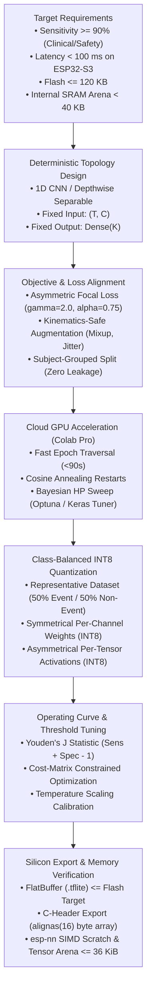

# Edge AI & TinyML Model Forge (`edge-ai-model-forge`)

Operational engineering specifications, mathematical optimization procedures, and cloud-to-silicon compilation pipelines for deploying high-reliability, ultra-low-power neural networks onto commodity microcontrollers (**ESP32-S3**, **ARM Cortex-M4/M7**, **nRF52840**, **STM32**) using **TensorFlow Lite for Microcontrollers (TFLite Micro)**, **CMSIS-NN**, and **esp-nn**.

---

## 1. Architectural Philosophy: The Bounded Silicon Contract

Edge AI on resource-constrained microcontrollers differs fundamentally from cloud/server deep learning. Model design is governed by **hard physical boundaries**, not unbounded parameter scaling:



---

## 2. Silicon Hardware Budget & Memory Constraints

### 2.1 The Two-Memory Rule (Flash vs Internal SRAM)

Microcontrollers maintain two distinct physical memory pools that impose orthogonal constraints:

| Memory Pool | Target Hardware | Allocation Component | Hard Constraint & Failure Mode |
| :--- | :--- | :--- | :--- |
| **Non-Volatile Flash (ROM)** | Flash partition (`.rodata`) | Model weights, biases, FlatBuffer schema, static C headers | Exceeding flash fails linker build (`region 'drom0_0_seg' overflowed`). Target: **$\le 120\text{ KB}$** (SPARK uses $18.5\text{ KB}$). |
| **Internal SRAM (RAM)** | Heap / BSS (`MALLOC_CAP_INTERNAL`) | **Tensor Arena** (runtime activations, double-buffered scratchpads, interpreter state) | Exceeding SRAM causes runtime allocation crash (`AllocateTensors() failed`). Target: **$< 40\text{ KB}$** of contiguous internal DRAM. |
| **External PSRAM (SPI RAM)** | Octal/Quad PSRAM | *Optional fallback arena* | External PSRAM incurs a **$15\%\text{--}30\%$ latency penalty** due to SPI memory bus bandwidth limits. Keep hot arenas internal. |

### 2.2 Mathematical Model Sizing & Tensor Arena Formulation

$$\text{Flash Footprint} = \sum_{l=1}^{L} \left( W_l \cdot 1\text{ byte} + B_l \cdot 4\text{ bytes} \right) + \text{FlatBuffer Overhead} \approx \sum W_l + 2.5\text{ KB}$$

$$\text{Peak Tensor Arena} = \text{Activation Storage} + \max\left(\text{Operator Scratch}\right) + \text{TFLM Interpreter Overhead}$$

#### Exact Memory Sizing Breakdown on ESP32-S3 (Xtensa LX7):
For an input window of $200 \times 6$ (or $256 \times 6$):
1. **Activation Tensors (INT8):** $\approx 8.8\text{ KiB}$ to $9.0\text{ KiB}$ (without memory reuse across non-overlapping lifetimes).
2. **`esp-nn` Pointwise 1x1 Scratch Workspace:**
   $$\text{Scratch}_{\text{pointwise}} = 24 \times C_{\text{in}} + 16{,}384 + 64$$
   For $C_{\text{in}} = 32$ channels, scratch request is **$17{,}216\text{ bytes}$ ($16.8\text{ KiB}$)**.
3. **`esp-nn` Depthwise Scratch Workspace ($k=5$, multiplier 1):**
   $$\text{Scratch}_{\text{depthwise}} = 2 \times (K + T) + 32 \approx 4{,}288\text{ bytes}$$
4. **TFLM Runtime Overhead & Alignment Reserve:** $\approx 10.0\text{ KiB}$.

$$\mathbf{\text{Total Internal SRAM Arena Allowance}} \approx 9\text{ KiB} + 17.2\text{ KiB} + 10\text{ KiB} = \mathbf{36.2\text{ KiB}} \quad (\mathbf{< 40\text{ KB Budget!}})$$

### 2.3 ESP32-S3 `esp-nn` SIMD Acceleration & Alignment
- **Vector Acceleration:** ESP32-S3 Xtensa LX7 features custom vector instructions. `esp-nn` assembly kernels achieve **$5.0\times\text{--}7.7\times$ speedups** over generic ANSI-C.
- **16-Byte SIMD Alignment:** Allocate heap memory with `MALLOC_CAP_SIMD` or specify `alignas(16)`. If unaligned, `esp-nn` drops back to slower non-vectorized paths.

---

## 3. Steering Training to Mission Requirements

### 3.1 Asymmetric Loss Functions (Prioritizing Safety & Recall)

In mission-critical monitoring (falls, seizures, industrial bearing failure), **False Negatives are life-threatening**, while **False Positives are mere inconveniences**. Standard Cross-Entropy treats errors symmetrically.

#### Focal Loss Formulation
Down-weights easy well-classified non-events ($p_t \to 1.0$) and magnifies loss on misclassified events:

$$\mathcal{L}_{\text{Focal}} = -\alpha_t (1 - p_t)^\gamma \log(p_t)$$

- **$\gamma = 2.0$ (range $1.5\text{--}3.0$):** Focusing parameter. Suppresses gradient of easy negatives by factor of $(1 - 0.99)^2 = 0.0001$.
- **$\alpha = 0.75$ (range $0.70\text{--}0.85$):** Balancing factor allocating $3\times$ higher baseline importance to the positive class.

```python
import tensorflow as tf

class AsymmetricFocalLoss(tf.keras.losses.Loss):
    """
    Focal Loss specially calibrated for edge event detection.
    gamma=2.0 suppresses easy background noise.
    alpha=0.75 heavily penalizes missed safety events.
    """
    def __init__(self, gamma: float = 2.0, alpha: float = 0.75, **kwargs):
        super().__init__(**kwargs)
        self.gamma = gamma
        self.alpha = alpha

    def call(self, y_true, y_pred):
        y_true = tf.cast(tf.squeeze(y_true), tf.int32)
        y_pred = tf.clip_by_value(y_pred, 1e-7, 1.0 - 1e-7)
        y_true_oh = tf.one_hot(y_true, depth=2)
        
        # Probability of true class
        p_t = tf.reduce_sum(y_true_oh * y_pred, axis=-1)
        focal_weight = tf.pow(1.0 - p_t, self.gamma)
        
        # Alpha weighting
        alpha_t = tf.where(tf.equal(y_true, 1), self.alpha, 1.0 - self.alpha)
        
        loss = -alpha_t * focal_weight * tf.math.log(p_t)
        return tf.reduce_mean(loss)
```

---

### 3.2 Operating Threshold Calibration & Cost-Matrix Optimization

**Never deploy an edge model with a fixed default $0.50$ threshold.** Select the operational cutoff post-training on a held-out calibration split using either:

1. **Youden's $J$ Index:** $J = \text{Sensitivity} + \text{Specificity} - 1 = \text{TPR} - \text{FPR}$.
2. **Cost Matrix Minimization:**
   $$R(t) = C_{FN} \cdot FN(t) + C_{FP} \cdot FP(t) + C_{TP} \cdot TP(t) + C_{TN} \cdot TN(t)$$
3. **Sensitivity-Constrained Thresholding:** Select the highest threshold that guarantees the lower $95\%$ bootstrap confidence interval for Sensitivity satisfies $\text{Sens} \ge 90\%$.

```python
from sklearn.metrics import roc_curve
import numpy as np

def calibrate_edge_threshold(y_val_true: np.ndarray, y_val_probs: np.ndarray, target_sens: float = 0.90) -> float:
    """Finds optimal operating cutoff guaranteeing safety-constrained sensitivity."""
    fpr, tpr, thresholds = roc_curve(y_val_true, y_val_probs)
    # Filter indices where sensitivity meets target
    valid_idx = np.where(tpr >= target_sens)[0]
    if len(valid_idx) > 0:
        # Choose the threshold that maximizes specificity among valid points
        best_sub_idx = np.argmin(fpr[valid_idx])
        best_threshold = thresholds[valid_idx[best_sub_idx]]
    else:
        # Fall back to Youden's J
        j_scores = tpr - fpr
        best_threshold = thresholds[np.argmax(j_scores)]
    return float(np.clip(best_threshold, 0.15, 0.85))
```

---

### 3.3 Kinematics-Safe Time-Series Augmentations

Time-series augmentations on IMU data must preserve underlying physical laws:
1. **Label-Preserving Mixup ($\lambda \ge 0.8$):** Blend pairs from the same activity group to regularize feature maps without creating phantom hybrid physics.
2. **Temporal Jitter ($\pm 10\text{--}15$ samples):** Circular or edge-padded shift representing varying sensor capture timing.
3. **Sensor Magnitude Scaling ($0.95\text{--}1.05$):** Multiplicative scale simulating slight variations in user body mass and speed.
4. **Physical Invariant Constraint:** **NEVER invert sensor frequency or apply arbitrary 3D axis permutation**, as it destroys the mandatory $1g$ gravitational downward reference vector.

---

## 4. Quantization & Dynamic Range Preservation

### 4.1 Sensor Range vs. Model Saturation Trap

- **Hardware Sensor Clipping:** If an IMU is configured to $\pm 8g$ and an impact reaches $12g$, the hardware register clips at $8g$. Software cannot reconstruct lost information. Always configure the physical IMU to $\pm 16g$ with adequate headroom.
- **Model Quantization Saturation:** Affine INT8 quantization maps real values $r$ to integer codes $q$:
  $$r = (q - Z) \cdot S \implies q = \text{round}\left( \frac{r}{S} \right) + Z$$
  For signed INT8 ($q \in [-128, 127]$), a positive zero-point $Z > 0$ reduces positive headroom to $(127 - Z) \cdot S$. High-$g$ shock impacts will saturate at $+127$ unless calibrated properly.

### 4.2 Class-Balanced Representative Calibration (50% Event / 50% Non-Event)

To prevent the calibration scale $S$ from compressing to quiet walking levels ($0g\text{--}2g$), representative datasets must strictly balance event and non-event windows:

```python
def make_balanced_calibration_generator(windows: np.ndarray, labels: np.ndarray, n_samples: int = 300):
    """Guarantees 50/50 dynamic range coverage across quiet motion and shock impacts."""
    pos_idx = np.where(labels == 1)[0]
    neg_idx = np.where(labels == 0)[0]
    
    n_pos = min(n_samples // 2, len(pos_idx))
    n_neg = min(n_samples - n_pos, len(neg_idx))
    
    chosen_pos = np.random.choice(pos_idx, size=n_pos, replace=False)
    chosen_neg = np.random.choice(neg_idx, size=n_neg, replace=False)
    calib_indices = np.concatenate([chosen_pos, chosen_neg])
    np.random.shuffle(calib_indices)
    
    calib_windows = windows[calib_indices].astype(np.float32)
    
    def generator():
        for i in range(len(calib_windows)):
            yield [calib_windows[i : i + 1]]
            
    return generator
```

### 4.3 PTQ vs. QAT Escalation Decision Matrix

```
       Start: Full-Integer PTQ (TFLITE_BUILTINS_INT8)
                           │
             Did Sensitivity drop > 1.5%
          or tail 8g-16g accuracy degrade?
                     /           \
                   NO             YES
                  /                 \
         [DEPLOY TO SILICON]    Escalate to QAT
                               (TensorFlow Model Optimization Toolkit)
                               Fine-tune pre-trained weights for 10 epochs
                               with simulated fake-quant noise.
```

---

## 5. Microcontroller Silicon Export (`alignas(16)`)

```python
def generate_aligned_c_header(tflite_bytes: bytes, header_path: str, model_name: str = "spark_cnn"):
    """Generates 16-byte aligned C header for ESP-IDF / CMSIS-NN compilation."""
    hex_data = [f"0x{b:02x}" for b in tflite_bytes]
    hex_lines = []
    for i in range(0, len(hex_data), 12):
        hex_lines.append("  " + ", ".join(hex_data[i : i + 12]))
    
    content = f"""// Auto-generated by edge-ai-model-forge -- do not edit manually.
// Target: ESP32-S3 (esp-nn) / ARM Cortex-M (CMSIS-NN)
// Model size: {len(tflite_bytes)} bytes

#pragma once
#include <stdalign.h>

alignas(16) const unsigned char {model_name}_model[] = {{
{',\\n'.join(hex_lines)}
}};

const unsigned int {model_name}_model_len = {len(tflite_bytes)};
"""
    with open(header_path, "w", encoding="utf-8") as f:
        f.write(content)
```

---

## 6. Cloud Acceleration & Google Drive Asset Delivery

When offloading edge AI model training, Bayesian tuning, or INT8 quantization sweeps to Cloud GPUs (e.g., Google Colab Pro L4 / A100):

### 6.1 Dual-Format Cloud Asset Staging Pattern
Never upload *only* a consolidated `.zip` archive to Google Drive. A zip archive prevents direct 1-click execution in Google Colab and forces manual local downloads.
Always stage assets in **dual format**:
1. **Uncompressed Executable Artifacts**:
   - Self-contained Colab notebook (`.ipynb`) uploaded uncompressed directly into the Google Drive folder.
   - Core Python scripts (`train_cnn.py`, `quantize_model.py`) uploaded uncompressed for inspection or direct module import.
   - Baseline compiled targets (`.tflite`, `.h`) for quick baseline comparison.
2. **Consolidated Data Bundle (`.zip`)**:
   - Pack high-volume multi-array dataset files (`windows.npy`, `labels.npy`, `meta.csv`) into a single `.zip` archive.
   - Enables fast 1-step runtime extraction in Colab via `!unzip -q`.

### 6.2 Standard Google Colab Ingestion Boilerplate
Every edge AI Colab notebook must include an automated Drive mounting, resilient dataset path resolution, and archive extraction cell:

```python
from google.colab import drive
import os, zipfile, glob
from pathlib import Path

# 1. Mount user's Google Drive
drive.mount('/content/drive')

# 2. Resilient dataset resolution (checks both uncompressed Drive uploads and zip bundles)
LOCAL_DATA_DIR = Path('/content/spark_data')
LOCAL_DATA_DIR.mkdir(parents=True, exist_ok=True)

# Check if uncompressed dataset files (.npy / .csv) are already mounted in Google Drive
drive_npy_matches = glob.glob('/content/drive/MyDrive/**/windows.npy', recursive=True)

if drive_npy_matches:
    found_dir = Path(drive_npy_matches[0]).parent
    print(f"[+] Detected uncompressed dataset files in Drive: {found_dir}")
    DATA_DIR = found_dir
else:
    # If not found uncompressed, search for the zip bundle and extract to high-speed NVMe local disk
    zip_matches = glob.glob('/content/drive/MyDrive/**/<DATASET_BUNDLE>.zip', recursive=True)
    if zip_matches:
        zip_path = zip_matches[0]
        print(f"[*] Extracting dataset from zip: {zip_path} -> {LOCAL_DATA_DIR}")
        with zipfile.ZipFile(zip_path, 'r') as zf:
            zf.extractall(LOCAL_DATA_DIR)
        DATA_DIR = LOCAL_DATA_DIR / 'data' if (LOCAL_DATA_DIR / 'data' / 'windows.npy').exists() else LOCAL_DATA_DIR
    else:
        raise FileNotFoundError("Dataset files (windows.npy or zip bundle) not found in Google Drive.")

print(f"[+] Verified DATA_DIR: {DATA_DIR}")
assert (DATA_DIR / 'windows.npy').exists()
```

### 6.3 Automated Persistence Back to Google Drive (Folder ID vs. Path Resolution)
Never rely on manual browser downloads from the ephemeral Colab file browser (`/content/`). Transient browser disconnections, tab crashes, or immediate programmatic teardowns (`runtime.unassign()`) permanently destroy unsaved weights.
Every training and quantization notebook must automatically locate the mounted Google Drive project folder and save output artifacts directly to Drive before teardown:

> **CRITICAL PITFALL (Folder ID vs. Mounted Folder Name):**
> Google Drive mounts into `/content/drive/MyDrive/` using human-readable folder names (e.g. `/content/drive/MyDrive/Share to Aaradhya/Super-NLM/SPARK`), **not** alphanumeric Folder IDs (such as `1_A54IjeWyIP6fVuXAUQtyoxYZd5U1RpD`).
> Attempting `glob.glob('**/<FOLDER_ID>*')` fails silently and returns an empty list, causing save routines to fall back to the ephemeral disk.
> **Rule:** Always reuse the detected dataset path `DATA_DIR` (or explicit folder path) as the persistence target, or search by dataset file ancestry (`Path(drive_npy_matches[0]).parent`). Never search the filesystem for Google Drive Folder IDs!

```python
import shutil, glob
from pathlib import Path

# 1. Resolve save target directly from the mounted dataset location or Drive path
save_target = Path('/content/drive/MyDrive/Share to Aaradhya/Super-NLM/SPARK')
if not save_target.exists():
    save_target = DATA_DIR if (DATA_DIR and DATA_DIR.exists()) else Path('/content')

# 2. Persist exported C header, quantized TFLite binary, and Keras checkpoint directly to Google Drive
try:
    shutil.copy('spark_cnn_int8.h', save_target / 'spark_cnn_int8_upgraded.h')
    shutil.copy('spark_cnn_int8.tflite', save_target / 'spark_cnn_int8_upgraded.tflite')
    model.save(save_target / 'spark_cnn_upgraded.keras')
    print(f"[+] Successfully saved upgraded models directly to Google Drive: {save_target}")
    # Enforce hard verification before proceeding to session teardown!
    assert (save_target / 'spark_cnn_int8_upgraded.h').exists(), "Persistence verification failed!"
except Exception as e:
    print(f"[!] Drive persistence warning: {e}")
```

### 6.4 Programmatic Compute Unit Conservation & Auto-Teardown (`runtime.unassign()`)
To prevent burning expensive Colab Pro compute units/credits while the VM sits idle after training finishes, the final cell must always execute a programmatic teardown.
**Teardown Pre-Condition:** `runtime.unassign()` must ONLY execute after `INV-CLOUD-AUTOSAVE` confirms that exported model files physically exist in Google Drive, preventing unassigning the runtime before artifacts are safely stored.

```python
print("[+] All training, quantization, and Drive exports completed successfully!")
print("[*] Programmatically unassigning runtime to conserve Colab compute credits...")

try:
    from google.colab import runtime
    runtime.unassign()
except Exception as e:
    print(f"[*] Note: runtime.unassign() called: {e}")
```

### 6.5 Dynamic Cell Queueing & In-Flight Safety Pattern
Appending or editing notebook cells (e.g. adding the auto-teardown cell `runtime.unassign()`, drive persistence logic, or extra metrics blocks) while long-running training epochs are currently running in-flight is **100% safe**. The Jupyter kernel operates asynchronously via a FIFO message queue; simply enqueue newly appended cells (`Shift + Enter` or Play button) so they show pending execution `[*]`. They will execute seamlessly immediately upon completion of the active cell without corrupting VRAM or disrupting CUDA execution.

---

## 7. Verification Checklist & Invariants

1. **`INV-FLASH-BUDGET`**: Quantized `.tflite` model size must be $\le 120\text{ KB}$ flash.
2. **`INV-SRAM-ARENA`**: Tensor arena requirement + `esp-nn` scratch buffer verified $\le 36.2\text{ KiB}$ internal SRAM.
3. **`INV-LEAKAGE-FREE`**: Evaluation split strictly isolated by `GroupShuffleSplit` on subject ID (zero data leakage across splits).
4. **`INV-CALIB-BALANCE`**: Quantization representative dataset includes at least 50% positive/shock class to prevent scale clipping.
5. **`INV-THRESHOLD-TUNED`**: Operating cutoff is explicitly recorded in `model_config.json` via Youden's $J$, not hardcoded to $0.50$.
6. **`INV-FIRMWARE-ALIGNMENT`**: Exported C header contains `alignas(16)` and matches the C++ struct definition in `firmware/main/models/`.
7. **`INV-IO-CONTRACT`**: Input dimensions `(T, C)` and output shape `(K)` must match the microcontroller driver circular buffer verbatim.
8. **`INV-CLOUD-DELIVERY` (Dual-Format Cloud Staging)**: When uploading models and training artifacts to Google Drive for cloud acceleration, never upload only a `.zip` archive. Upload the self-contained `.ipynb` notebook and execution scripts uncompressed directly to the Drive folder so they can be opened immediately via "Open with Google Colaboratory", alongside the `.zip` dataset bundle for fast runtime decompression.
9. **`INV-CLOUD-AUTOSAVE` (Drive Persistence Before Teardown)**: All cloud training notebooks must automatically save generated artifacts (`.h`, `.tflite`, evaluation reports) directly into the mounted Google Drive folder before completion. Never glob or search the filesystem for alphanumeric Google Drive Folder IDs (Drive mounts folders by human-readable names); always resolve targets via `DATA_DIR` or dataset parent ancestry. The notebook must assert artifact presence in Drive *before* executing `runtime.unassign()`.
10. **`INV-CLOUD-TEARDOWN` (Programmatic Session Unassign)**: All cloud GPU training notebooks must terminate with a programmatic `runtime.unassign()` cell to immediately release GPU hardware and conserve compute units/credits upon run completion, guarded by `INV-CLOUD-AUTOSAVE`.
11. **`INV-INFLIGHT-SAFETY` (FIFO Kernel Queue Safety)**: In-flight execution is asynchronous; editing or queueing new cells while training runs is safe via FIFO queueing without restarting the runtime.
12. **`INV-LABEL-POLYMORPHISM` (Polymorphic Label Ingestion)**: Time-series IMU datasets (SisFall, UniMiB SHAR, MobiAct) frequently persist raw alphanumeric activity codes (e.g. `'D01'`–`'D19'` for ADL, `'F01'`–`'F15'` for falls) rather than pre-binarized `0/1` integers. Ingestion pipelines and notebooks must never assume integer dtypes or cast raw labels directly via `.astype(np.int32)` (which throws `ValueError: invalid literal for int() with base 10`). Always inspect `raw_labels.dtype.kind` and apply vectorized prefix matching (`np.where(np.char.startswith(raw_labels.astype(str), 'F'), 1, 0).astype(np.int32)`) to seamlessly accommodate both raw alphanumeric codes and pre-binarized integers.


