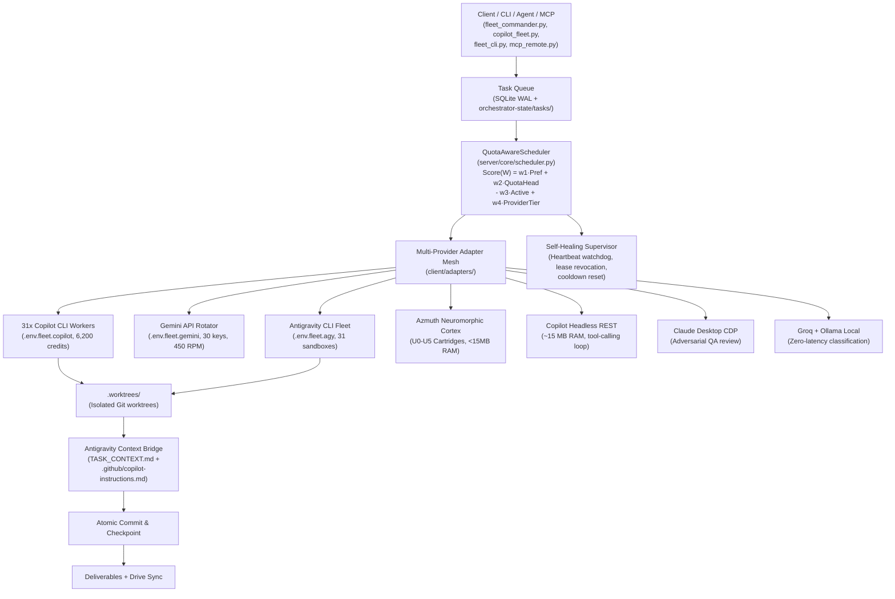

# Fleet-Orchestrator Swarm Control Skill

Operational commands, architectural guidelines, and execution workflows for **Fleet-Orchestrator** (`F:\Aaradhya-Dev-Tamrakar\Fleet-Orchestrator`), a production-grade autonomous multi-model agent fleet and swarm platform that pools heterogeneous AI compute models into a unified, high-concurrency autonomous swarm. **583 tests, 100% pass rate across 75+ test suites.**

---

## 1. Architecture Overview



### Core Systems

| Component | Location | Purpose |
|:---|:---|:---|
| **QuotaAwareScheduler** | `server/core/scheduler.py` | Multi-factor scoring: capability match, quota headroom, provider tier weight, concurrency penalty. Stage affinity bonuses (`+0.20` for code on Copilot CLI). |
| **PipelineEngine** | `server/core/pipeline_engine.py` | Decomposes jobs into DAG-staged tasks, manages stage advancement, QA gates, job finalization. |
| **ScratchpadManager** | `server/core/scratchpad_manager.py` | 3-section persistent Markdown shared state (Plan → Diffs → QA Verdict) with atomic `os.replace` writes and exclusive lock files. |
| **Supervisor** | `server/core/supervisor.py` | Self-healing loop: stale heartbeat detection (>120s), expired lease reclamation, cooldown timer resets. |
| **Credit Ledger** | `tools/credit_ledger.py` | Leaf accounting engine with OS file locks (`msvcrt`/`fcntl`), per-worker sidecar ledgers, `(file_size, mtime)` event cache, automatic month rollover. |
| **Azmuth Ultimatrix** | `tools/azmuth_*.py`, `tools/ultimatrix_*.py` | Genomic algorithmic synthesis, allele racing, and multi-tier DNA splicing engine (`azmuth_gene_catalog.py`, `ultimatrix_splicer.py`, `ultimatrix_arena.py`, `ultimatrix_mutator.py`). |
| **Antigravity Bridge** | `client/antigravity_bridge.py` | Harvests live chat state, conversation transcripts, active artifacts, and Antigravity customizations; projects `TASK_CONTEXT.md` + `.github/copilot-instructions.md` into worktrees. |
| **Fleet Env Loader** | `tools/fleet_env.py` | Zero-friction cascading loader across `.env.fleet.copilot`, `.env.fleet.gemini`, `.env.fleet.agy`, and `.env.fleet`. |
| **Remote MCP Server** | `server/mcp_remote.py` | 23-tool Streamable HTTP/SSE MCP server: `create_task`, `list_tasks`, `acquire_task`, `claim_task`, `renew_task_lease`, `submit_checkpoint`, `submit_qa_review`, `submit_job_from_template`, `register_worker`, `worker_heartbeat`, `push_memory`, `search_memory`, `read_team_context`, and more. |

### Multi-Provider Adapter Mesh (`client/adapters/`)

| Adapter | Class | Capabilities |
|:---|:---|:---|
| **Copilot CLI** | `CopilotCLIAdapter` | `copilot.exe --autopilot` with `--disallow-temp-dir`, `--headless`, `COPILOT_ALLOW_ALL=true`, `COPILOT_FORCE_WINDOWS_HIDE=1`, `COPILOT_DEBUG_SKIP_LAUNCH_CHECKS=1`, subprocess token injection, worktree sandboxing, `totalNanoAIU` credit parsing, direct SQLite session telemetry (`session-state.db`), and discrete rate-limit classification. |
| **Copilot Headless** | `CopilotHeadlessAdapter` | Pure async HTTP REST + OpenAI-compatible tool-calling loop (`read_file`, `write_file`, `run_command`). ~15 MB RAM per instance. |
| **Claude Desktop CDP** | `ClaudeDesktopCDPAdapter` | Chrome DevTools Protocol via WebSocket. DOM injection + WinPilot fallback. Model selection, thinking budget, cooldown detection. |
| **Claude Desktop Proxy** | `ClaudeDesktopProxyAdapter` | Higher-level Claude Desktop proxy with session management. |
| **Gemini API** | `GeminiAPIAdapter` | `google-genai` SDK v2.25.0. Gemini 3.8 Flash default. Deprecated model auto-mapping. Token usage telemetry extraction. |
| **Gemini Rotator** | `GeminiKeyRotator` | Multi-key round-robin rotation with 2-tier cooldown (429 burst + 00:00 UTC daily reset). |
| **AGY CLI** | `AGYCLIAdapter` | `agy.exe -p` print mode with `--dangerously-skip-permissions`, isolated `AGY_WORKER_HOME` sandboxes, and structured JSON output. |
| **Gemini Free** | `GeminiFreeAdapter` | Backward-compatible free-tier adapter. |
| **Groq** | `GroqAdapter` | Cloud Groq LLM API for fast formatting and classification. |
| **Ollama Local** | `OllamaLocalAdapter` | Local open-weight models via Ollama HTTP API. |
| **WinPilot Bridge** | `WinPilotBridge` | Win32 UI Automation bridge for physical desktop input coordination across Claude Desktop instances. |

---

## 2. CLI Commands & Operational Workflows

### Unified In-Terminal CLI (`fleet.bat`) & Silicon Telemetry
```powershell
.\fleet.bat status                          # Live status with Silicon Topology (NPU/iGPU/CPU) & quota
.\fleet.bat submit "Implement feature X" --auto-tier balance --priority HIGH
.\fleet.bat submit "Quick bugfix" --auto-tier efficiency
.\fleet.bat submit "Complex architecture" --auto-tier intelligence --model gemini-3.8-flash
.\fleet.bat daemon --concurrency 4          # Start local background queue worker daemon
```

### Antigravity 2.0 Background Task Handoff Protocol
When delegating work from Antigravity, handoff tasks directly as native **Background Tasks** via `run_command` with low `WaitMsBeforeAsync` (2000ms). This renders execution live inside Antigravity 2.0's HTML Auxiliary Pane (**Background Tasks** tab), preserves the Context Firebreak (`INV-CTX-FIREBREAK`), costs **$0.00** LLM polling tokens, and reactively wakes the agent upon completion:

```powershell
# Atomic one-shot handoff (Submits task, pre-flights, and executes unbuffered worker)
.\fleet.bat run-task --spec "Implement edge sensor calibration" --auto-tier balance --conversation-id <uuid>

# Cross-repository handoff (Routes worktree to external repository, e.g. SPARK)
.\fleet.bat run-task --spec "Refactor telemetry pipeline" --target-repo "F:\Aaradhya-Dev-Tamrakar\SPARK"

# Dry-run handoff (Zero-credit simulation)
.\fleet.bat run-task --spec "Scaffold schema validator" --dry-run
```

**Agent Handoff Lifecycle**:
1. **Dispatch**: Agent calls `run_command` with `CommandLine: ".\fleet.bat run-task --spec \"...\" --conversation-id <uuid>"`, `WaitMsBeforeAsync: 2000`, `IsDaemon: false`.
2. **Immediate Receipt**: Antigravity registers `task-<id>` in the Background Tasks pane. Agent returns a brief receipt to the user and yields turn control.
3. **Live Stream**: User watches real-time milestones (`[CLAIMED]`, `[WORKTREE]`, `[EXEC]`, `[PROGRESS]`, `[CHECKPOINT]`, `[COMPLETED]`) in the Auxiliary Pane.
4. **Reactive Wakeup**: On process exit, Antigravity reactively delivers the bounded manifest ($\le 300$ words).
5. **Delivery Gate**: Agent inspects `orchestrator-state/checkpoints/<task_id>.json`, verifies tests, and proposes the merge into the active branch via `git merge task/<task_id>` + `.\sync.bat`.

### Tri-Fleet Environment Configuration & Auditing
Multi-model worker pools are configured across modular provider files with cascading fallback to legacy `.env.fleet`:
- `.env.fleet.copilot`: 31 GitHub Copilot accounts (Fine-Grained PATs, 6,200 monthly AI credits).
- `.env.fleet.gemini`: Google AI Studio Gemini API keys (30 healthy GCP project keys active, pooled 450 RPM / 45,000 RPD).
- `.env.fleet.agy`: Google Antigravity CLI worker pool (31 isolated sandboxes `~/.agy-workers/worker_N`, `agy.exe -p`, `--dangerously-skip-permissions`).


```powershell
python tools/fleet_env.py                    # Audit all 3 fleet env files and merged config
python tools/unified_fleet_cli.py status     # Live telemetry across Copilot, Gemini, and AGY pools
python tools/unified_fleet_cli.py watch      # In-terminal live HUD (zero popups)
```

### 1st-Party Copilot CLI Auto-Tier Steering & Escalation
`copilot.exe` natively supports automatic model tier steering via `--auto-tier`:
- `--auto-tier efficiency`: Lightweight models (e.g. GPT-4o-mini / Haiku class) for routine fast paths and small edits. Saves quota credits.
- `--auto-tier balance`: Balanced reasoning and coding speed for medium-complexity implementations.
- `--auto-tier intelligence`: Frontier reasoning models for architectural refactoring, complex algorithms, or high blast-radius files.
- **Model Escalation**: Direct override via `--model <name>` (e.g. `--model gemini-3.8-flash`, `claude-3.7-sonnet`, `o3-mini`).

#### Tier-Aware Timeout Floor Escalation
The SLM router (`fast_intent_router.py`) computes a `timeout_ceiling_s` from prompt semantics (formula: `min(1200, max(30, duration_s × 2.2))`). When the user explicitly passes `--auto-tier`, the CLI enforces a **minimum floor** to prevent the SLM's ceiling from being too tight for the selected tier:

| Auto-Tier | Timeout Floor | Use Case |
|:---|:---|:---|
| `efficiency` | 120s | Fast edits, linting, small fixes |
| `balance` | 300s | Medium implementations, docstrings, refactoring |
| `intelligence` | 600s | Architectural rewrites, complex algorithms |

If the SLM computes a ceiling below the tier floor, the ceiling is escalated to the floor. This prevents timeout failures when the SLM underestimates task complexity.

#### Time Allocation Tiers (SLM Router Classification)

| Tier | Est. Duration | Typical Tasks |
|:---|:---|:---|
| `T0_MICRO` | ~12s | Short prompts with `DIRECT_FAST` policy |
| `T1_FAST` | 35–50s | General tasks, word count > 25 |
| `T2_MEDIUM` | 63–120s | Documentation, refactoring, audits, scaffolding, ML/AI tasks |
| `T3_LONG` | 240s | Batch, swarm, fleet, worker pool tasks |

### Meteor Lake Tri-Hardware Runtime (`AUTO:NPU,GPU,CPU`)
On Intel Core Ultra 7 155H (16 cores / 22 threads, 11 TOPS NPU, 8 Xe-cores Arc iGPU), the local SLM inference engine executes across 4 cascading tiers:
1. **Level 1 (NPU - 11 TOPS)**: OpenVINO GenAI INT4 via `.venv-npu` (Python 3.12.10). Zero host CPU utilization (~2W envelope).
2. **Level 2 (Arc iGPU - 8 Xe)**: OpenVINO GPU device target (`GPU.0`). High-throughput batch inference.
3. **Level 3 (CPU AVX-VNNI)**: LM Studio / llama.cpp local server at port 1234 (`Qwen2.5-0.5B-Instruct-Q4_K_M.gguf`).
4. **Level 4 (Heuristic Fast Path)**: Zero-weight keyword & AST classifier (<1ms, 0 MB RAM).

Setup & Verification:
```powershell
.\setup_npu_env.bat                         # Provision .venv-npu and install OpenVINO GenAI
python tools/npu_engine.py --status         # Audit physical NPU/GPU/CPU devices and compile cache
python tools/npu_engine.py "Prompt text"    # Execute triage across tri-hardware mesh
```

### Quota Reconciliation & Live Dashboard
```powershell
python tools/copilot_fleet.py reconcile     # Harvest authentic session logs into per-worker sidecars
python tools/copilot_fleet.py dashboard     # Real-time ASCII burn-rate meter & worker topology
python tools/copilot_fleet.py dashboard --json  # Machine-readable JSON telemetry
```

### Context-Firebreak Batch Execution (Fleet Commander)
Enforces `INV-CTX-FIREBREAK`: redirects child output to isolated logs, computes health ratio $H$, emits $\le 300$-word manifests.
```powershell
python tools/fleet_commander.py --specs "Implement feature A" "Refactor module B" --concurrency 2
python tools/fleet_commander.py --file tasks.json --dry-run
python tools/fleet_commander.py --specs "Task" --conversation-id <uuid>  # Inherit Antigravity context
python tools/fleet_commander.py --specs "Task" --no-antigravity          # Disable context inheritance
```

### Autonomous Task Submission & Batch
```powershell
python tools/copilot_fleet.py submit --spec "Implement X" --kind code --auto-tier balance
python tools/copilot_fleet.py batch --specs "Task 1" "Task 2" --concurrency 4
```

### Copilot Queue Worker (Background Daemon)
```powershell
python tools/copilot_queue_worker.py --concurrency 4                    # Poll & claim tasks
python tools/copilot_queue_worker.py --worker-id copilot-w1 --once      # Single task, specific worker
python tools/copilot_queue_worker.py --dry-run --task-id <id>           # Simulate without copilot.exe
python tools/copilot_queue_worker.py --no-worktree                      # Disable git worktree isolation
```

### Fast Intent Router (<50ms)
```powershell
python tools/fast_intent_router.py "dispatch swarm task across copilot fleet"
```
Routes via Meteor Lake Tri-Hardware (OpenVINO INT4 on NPU/iGPU) → LM Studio HTTP (1234) → heuristic fallback. Returns structured `{archetype, tier, matrix_cell, policy, primary_skill, velocity, auto_tier, recommended_copilot_model, time_allocation}`.

**Keyword Classification Branches** (heuristic fallback):
- **Fleet/Swarm** (`batch`, `swarm`, `fleet`, `worker pool`) → `T3_LONG` (240s)
- **AI/ML** (`mlops`, `text-to-sql`, `vision transformers`, `rag assistant`) → `T2_MEDIUM` (90s)
- **Scaffolding** (`scaffold`, `pipeline`, `syllabus`) → `T2_MEDIUM` (120s)
- **Surgical** (`refactor`, `audit`, `access.js`) → `T2_MEDIUM` (75s)
- **Documentation** (`docstring`, `jsdoc`, `typehint`, `type annotation`, `add comments`) → `T2_MEDIUM` (90s)
- **Medium verbosity** (word count > 25) → `T1_FAST` (50s)
- **Micro** (word count < 8, `DIRECT_FAST`) → `T0_MICRO` (12s)
- **Default** → `T1_FAST` (35s)

### SKU Task Dispatching
```powershell
python scripts/dispatch_iv_ii_tasks.py              # IV-II academic study packs
python scripts/dispatch_iv_ii_tasks.py --dry-run     # Preview without enqueuing
```

### Google Drive & NotebookLM Sync
```powershell
python scripts/sync_drive.py --push         # Push markdown to Google Drive (SHA-256 change detection)
python scripts/sync_drive.py --push --sync-nlm  # Also trigger NotebookLM source sync
python scripts/sync_drive.py --dry-run      # Preview changes without uploading
```
- **Drive Folder**: `1wGq53okV7ZaFGSw2fWilEfxL4FEIVeIF`
- **NotebookLM**: `6a37d992-6ceb-4d72-a909-e10e9cca32b6`

### FastAPI Server
```powershell
uvicorn server.main:app --host 0.0.0.0 --port 8000  # Start orchestration backend
```
REST API: `/api/v1/tasks`, `/api/v1/workers`, `/api/v1/jobs`, `/api/v1/memory`, `/api/v1/context`, `/api/v1/workers/quota-dashboard`. MCP endpoint: `/mcp`.

### One-Click Launchers
```powershell
.\launch_copilot_fleet.bat                  # Multi-account fleet launcher
.\launch_fleet_gui.bat                      # Fleet Control Center GUI v2.0
```

### Azmuth Ultimatrix & Genomic Splicing (`tools/azmuth_*.py`, `tools/ultimatrix_*.py`)
The Azmuth Ultimatrix pipeline sequences, mutates, and splices algorithmic DNA across **5 hierarchical Gene Tiers (Tier 0 to Tier 4)**:
- **Tier 0 (Hardware Substrate)**: AVX2/SIMD bitwise intrinsics, cache-aligned arrays, `FAST_IO_STREAM_UNTIE`, `INTERACTIVE_STREAM_IO`.
- **Tier 1 (Language Runtime)**: `SplitMix64` anti-hash collision, unbounded recursion limits, `FAST_MODULAR_EXPONENTIATION`, `EXTENDED_EUCLIDEAN_GCD`, `BINARY_SEARCH_ON_ANSWER`.
- **Tier 2 (Primitives & Graph Structures)**: `DISJOINT_SET_UNION`, `FENWICK_BINARY_INDEXED_TREE`, `SEGMENT_TREE_RANGE_QUERY`, `DIJKSTRA_SHORTEST_PATH`, `TRIE_PREFIX_TREE`, `SPARSE_TABLE_RMQ`.
- **Tier 3 (Dimensional Collapse & Cubic Breakers)**: $O(N^3) \to O(N^2)$ reduction, 64-way bitset Floyd-Warshall, `DINIC_MAX_FLOW`, `MIN_COST_MAX_FLOW`, `TWO_SAT_SOLVER`, `CONVEX_HULL_TRICK`, Knuth DP, `HEAVY_LIGHT_DECOMPOSITION`, `MO_ALGORITHM_OFFLINE`.
- **Tier 4 (Frontier Mathematics & Symbolic CAS)**: `POLLARDS_RHO_PRIME_FACTORIZATION`, `MILLER_RABIN_PRIMALITY_TEST`, `NUMBER_THEORETIC_TRANSFORM_NTT`, Chinese Remainder Theorem, Lucas' Theorem.

```powershell
# Splice verified algorithmic DNA directly into clean C++ solution
python tools/ultimatrix_splicer.py --genes FAST_IO_STREAM_UNTIE,DISJOINT_SET_UNION,DIJKSTRA_SHORTEST_PATH --output solution.cpp

# Autonomous allele mutation & arena racing
python tools/ultimatrix_mutator.py --mutate-batch 3
python tools/ultimatrix_arena.py --race-all
```

### Verification & Testing

```powershell
pytest tests/                                           # Full test suite
pytest tests/test_copilot_cli_adapter.py -v             # Adapter verification
pytest tests/test_copilot_headless.py -v                # Headless adapter tests
pytest tests/test_ultimatrix_splicer.py -v              # Ultimatrix gene splicer verification
pytest tests/test_ultimatrix_closed_loop.py -v          # End-to-end allele selection & arena racing
pytest tests/test_azmuth_daemon.py -v                   # Azmuth daemon & RAM circuit breaker tests
pytest tests/test_quota_reconciliation.py -v            # Credit ledger invariants
pytest tests/test_antigravity_bridge.py -v              # Context bridge tests
pytest tests/test_concurrency_stress.py -v              # Multi-worker race-freedom
pytest tests/test_copilot_queue_worker.py -v            # Persistent circular round-robin tests
pytest tests/test_e2e_pipeline.py -v                    # End-to-end DAG pipeline
```

---

## 4. Key Invariants & Best Practices

1. **Context Firebreak (`INV-CTX-FIREBREAK`)**: Never manage queues or poll logs directly from the main chat thread. Delegate batch workloads to Fleet Commander or ephemeral subagents. Keep parent context <5,000 tokens.
2. **Subprocess Isolation**: Every Copilot worker receives its own `COPILOT_GITHUB_TOKEN` and `COPILOT_HOME` directory. Never share credentials across processes.
3. **Worktree Hygiene**: All tasks execute inside ephemeral git worktrees under `.worktrees/`. Workers auto-commit changes, submit checkpoints, and tear down worktrees.
4. **Atomic Claims**: Task acquisition uses kernel-level `O_CREAT | O_EXCL` claim tokens (file-based queue) or SQLite compare-and-swap (server queue) to prevent double claims.
5. **Antigravity Context Projection**: When `--no-antigravity` is not set, Fleet Commander automatically harvests the active Antigravity conversation and projects `TASK_CONTEXT.md` + `.github/copilot-instructions.md` into each worktree.
6. **Credit Accounting**: The credit ledger (`tools/credit_ledger.py`) is a strict leaf module with zero repo imports. Uses OS file locks and `(file_size, mtime)` caching for authentic session-based accounting.
7. **Selective CI Bypass**: Use `.\sync.bat -SkipCI` for non-code changes. `sync.ps1` automatically detects non-code staged changes and appends `[skip ci]`.
8. **Version Control**: All commits via `.\sync.bat` — never raw `git add/commit/push`.
9. **Tri-Fleet Isolation & Quota Multipliers**:
   - Copilot: GitHub Fine-Grained PATs with "Copilot Requests" R/W and 90-day expiry.
   - Gemini: Google AI Studio keys generated in separate GCP projects to multiply RPM/RPD without hitting single-project bottlenecks.
   - AGY: Headless CLI workers require isolated `AGY_WORKER_HOME` sandboxes to prevent SQLite lock collisions on `conversation_summaries.db`, plus mandatory `--dangerously-skip-permissions`.
10. **Tier-Aware Timeout Floor (`INV-TIER-FLOOR`)**: The `--auto-tier` flag enforces minimum timeout floors (`efficiency`→120s, `balance`→300s, `intelligence`→600s). The SLM's computed `timeout_ceiling_s` is escalated to the tier floor when it falls below, preventing timeout kills on correctly-scoped tasks.
11. **Persistent Circular Round-Robin (`INV-CIRCULAR-ROBIN`)**: Worker rotation across the 31 pooled accounts must persist across separate processes, CLI commands, and restarts via `orchestrator-state/round_robin_pointer.json` guarded by an OS file lock (`FileLock`). Never rely on in-memory counters for round-robin dispatch; every one-shot task must advance circularly (`w1 → w2 → ... → w31 → w1`) to prevent front-loaded credit bias on `copilot-w1`.

12. **Task Eligibility & Kind/Stage Contract (`INV-TASK-ELIGIBILITY`)**: `copilot_queue_worker.py` determines worker task eligibility strictly via:
    ```python
    stage = data.get("current_stage") or data.get("stage") or (data.get("pipeline_stages")[0] if data.get("pipeline_stages") else None)
    is_eligible = (data.get("kind") == "code") or (stage in ["code", "draft", "research", "format", "refactor", "unit_test"])
    ```
    **The Trap**: Enqueuing tasks via `unified_fleet_cli.py submit --kind research` (or `--kind text`, `--kind qa`) sets `kind: "research"` while leaving `stage` unset (`None`). As a result, `is_eligible` evaluates to `False`, causing the Copilot worker pool to silently ignore the pending task indefinitely without claiming it.
    **The Invariant**: Whenever dispatching tasks intended for Copilot queue workers, ALWAYS either:
    - Use `--kind code` (the universal primary execution kind), OR
    - Ensure the task JSON explicitly defines `"stage": "research"` (or `"code"`, `"draft"`, etc.) alongside `kind`. `unified_fleet_cli.py` now guarantees this by propagating `task["stage"] = args.kind`.
13. **Daemon vs Batch Lifecycle & Drain Invariant (`INV-DAEMON-LIFECYCLE`)**:
    `copilot_queue_worker.py` (and `fleet.bat daemon`) historically defaulted to an open-ended daemon polling indefinitely (`poll_interval=5.0s`). However, because distinct tasks have heterogeneous requirements, budgets, and credit ceilings, swarms MUST never be left running as unclosed background zombies.
    - **Finite Swarms & Batches**: ALWAYS run with `--drain` (or `--exit-when-empty`), e.g.:
      `python tools/copilot_queue_worker.py --concurrency 3 --drain`
      The worker will process all queued tasks, wait for in-flight executions across all worker threads to finalize, and cleanly auto-exit the moment the queue is drained.
    - **Idle Guardrail**: Pass `--idle-timeout <seconds>` (e.g. `--idle-timeout 15`) so the worker automatically shuts down if no work arrives within the timeout window.
    - **Isolated Commander Batches**: Use `python tools/fleet_commander.py --specs "..."` which redirects child logs and exits immediately upon completion.
    - **One-Shot Tasks**: Use `--once` (`python tools/copilot_queue_worker.py --once`) or `fleet.bat run-task --spec "..."`.
14. **Headless Runtime Hardening & Direct Telemetry (`INV-HEADLESS-HARDENING`)**:
    Workers driving `copilot.exe` (`CopilotCLIAdapter`) enforce headless execution flags: `--disallow-temp-dir`, `--headless`, `COPILOT_ALLOW_ALL=true`, `COPILOT_FORCE_WINDOWS_HIDE=1`, and `COPILOT_DEBUG_SKIP_LAUNCH_CHECKS=1`. Telemetry is extracted directly from `session-state.db` via `extract_sqlite_session_telemetry()`, bypassing ephemeral files, and rate limits are classified into discrete `RATE_LIMIT_HOURLY` and `RATE_LIMIT_DAILY` tiers with automated cooldown governance.

---

## 5. Directory Layout Reference

```
Fleet-Orchestrator/
├── server/                        # FastAPI backend + MCP remote (23 tools)
│   ├── main.py                    # App entrypoint & supervisor lifecycle
│   ├── mcp_remote.py              # Hosted Remote MCP Server (23 tools)
│   ├── api/                       # REST routes (jobs, tasks, workers, memory)
│   ├── core/                      # scheduler, supervisor, pipeline_engine, scratchpad_manager, auth, config, database, observability
│   ├── database/schema.sql        # 9-table SQLite WAL schema
│   ├── models/schemas.py          # Pydantic request/response models
│   └── Dockerfile                 # Container packaging
│
├── client/                        # Autonomous worker daemons & adapter mesh
│   ├── worker_daemon.py           # Polling daemon (registers, claims, executes)
│   ├── fleet_supervisor.py        # Multi-worker fleet supervisor with role capabilities
│   ├── antigravity_bridge.py      # Antigravity context harvesting & worktree projection
│   └── adapters/                  # 10 provider adapters (Copilot, Gemini, AGY, Claude, Groq, Ollama, Colab)
│
├── tools/                         # CLI controllers & dashboards
│   ├── fleet_env.py               # Cascading loader across .env.fleet.{copilot,gemini,agy}
│   ├── unified_fleet_cli.py       # Zero-distraction in-terminal HUD (fleet status/submit/tasks/watch)
│   ├── copilot_fleet.py           # Multi-account fleet controller (status/canary/dashboard/reconcile/submit/batch)
│   ├── copilot_queue_worker.py    # Background queue worker with worktree isolation
│   ├── fleet_commander.py         # Context-firebreak batch orchestrator (≤300 word manifests)
│   ├── fleet_cli.py               # Claude Desktop multi-instance fleet CLI
│   ├── fleet_gui.py               # Fleet Control Center v2.1 (Tkinter High-DPI GUI with Azmuth Tab 6)
│   ├── fleet_watchdog.py          # Fleet health watchdog
│   ├── azmuth_github_sensor.py    # 4-stream GitHub sensory radar (U3, U1/U2, Codon, U0) with PAT rotation & Thalamic filter
│   ├── azmuth_gui.py              # Native Win32 60FPS Mission Control & Phylogenetic Gene Visualizer
│   ├── azmuth_tray.py             # Silent system tray controller (pythonw.exe GUI subsystem)
│   ├── azmuth_daemon.py           # Autonomous 24h background daemon with burst subtasks
│   ├── azmuth_market_sensor.py    # 3-stream live market/macro sensor
│   ├── azmuth_macro_graph.py      # 6-universe neuromorphic foresight engine (U0-U5)
│   ├── dag_planner.py             # Autonomous CPM DAG planner with topological sorting
│   ├── github_issue_sentinel.py   # Autonomous GitHub sentinel polling sentinel-ready issues
│   ├── fast_intent_router.py      # Sub-50ms local Qwen GGUF intent router
│   ├── npu_engine.py              # Intel Core Ultra NPU/iGPU/CPU multi-silicon engine
│   ├── credit_ledger.py           # Leaf credit ledger with OS file locks
│   ├── ci_secret_scanner.py       # Pre-commit secret leakage scanner
│   ├── ci_self_healing_runner.py  # Self-healing test runner with flaky retries
│   ├── md2pdf_app.py              # Markdown to PDF desktop app
│   └── stress_test_concurrency.py # Multi-worker concurrency stress harness
│
├── scripts/                       # Dispatchers & sync engines
│   ├── install_azmuth_task.ps1    # Windows startup installer registering pure GUI pythonw.exe
│   ├── dispatch_iv_ii_tasks.py    # IV-II academic study pack task dispatcher
│   ├── sync_drive.py              # Zero-dependency Google Drive sync (urllib + SHA-256)
│   └── upload_large_model_to_drive.py # Resumable chunked upload for ML models
│
├── mcp-servers/                   # Standalone MCP server packages
│   ├── orchestrator-mcp/          # Core orchestrator MCP
│   ├── cloud-orchestrator-mcp/    # Cloud orchestrator MCP
│   ├── md2pdf-mcp/                # Markdown→PDF MCP
│   ├── notebooklm-mcp/            # NotebookLM MCP
│   └── super-nlm-mcp/             # Super-NLM MCP
│
├── sku-templates/                 # Declarative DAG job templates
├── orchestrator-state/            # Live state (tasks/, checkpoints/, ledger/, scratchpads/, memory/, live-status/)
├── worker-prompts/                # 6 specialized role prompts (orchestrator, researcher, writer, qa-reviewer, seo-optimizer, formatter)
├── models/                        # Local GGUF model weights (git-ignored)
├── tests/                         # 587 automated pytest tests (75+ test suites)
├── .github/workflows/             # CI (dynamic matrix), self-healing watchdog, Drive sync
├── .env.fleet.copilot.example     # 31-account GitHub Copilot PAT template (6,200 monthly credits)
├── .env.fleet.gemini.example      # 32-slot Google AI Studio Gemini API key template
├── .env.fleet.agy.example         # 31-worker Antigravity CLI worker pool template
├── .env.fleet.example             # Consolidated legacy token template
├── drive-manifest.json            # Google Drive sync manifest with file IDs
├── sync.bat / sync.ps1            # Ecosystem sync with selective CI bypass
├── launch_azmuth_gui.bat          # One-click Azmuth Command Center GUI launcher (pythonw.exe)
├── launch_azmuth_tray.bat         # One-click silent tray launcher (pythonw.exe)
└── launch_fleet_gui.bat           # One-click GUI launcher
```

---

## 6. Azmuth Autonomous GitHub Sensory Radar & Silent Tray Runtime

### Autonomous GitHub Sensory Radar (`tools/azmuth_github_sensor.py`)
- **4 Autonomous Universe Streams**:
  - `U3 Career & Lab Alpha`: Tracks tier-1 AI research labs, fellowship challenges, and grant opportunities.
  - `U1/U2 SOTA AI Releases`: Tracks frontier model weights, inference speedups, and quantization breakthroughs.
  - `Codon Stream CP Templates`: Harvests new algorithmic templates, CP problem solutions, and data structures into the genetic vault.
  - `U0 Ecosystem Health`: Audits repositories across the ecosystem for broken workflows, commits, and open issues.
- **Quota Resilience**: Rotates requests across 30 discovered PATs from `.env.fleet.copilot`.
- **Thalamic Habituation**: Filters low-magnitude noise (`|Z| < 0.8σ`), outputting high-signal digests to `orchestrator-state/github_intelligence_brief.md`.

### Silent Windows 11 GUI Subsystem Runtime (`IMAGE_SUBSYSTEM_WINDOWS_GUI`)
- **Zero-Window Invariant**: Windows 11 ConPTY / Windows Terminal displays a blank window when running `powershell.exe -WindowStyle Hidden` on startup. To prevent this, `FleetAzmuthTray` and `launch_azmuth_tray.bat` invoke `pythonw.exe` directly.
- **System Tray Icon**: Lives in the notification area with circular gear icon, providing tactile status checks, codon counts, manual radar triggers, and one-click launch of the Command Center GUI.

---

## 7. Azmuth Neuromorphic Command Center GUI & Phylogenetic Gene Visualizer

### Native Desktop Command Center (`tools/azmuth_gui.py`)
- **Mission Control Layout & Oscilloscope**:
  - Standalone Win32 High-DPI Tkinter Canvas with Windows 11 dark mode (`DwmSetWindowAttribute`).
  - Hardware-smooth 60 FPS real-time RAM oscilloscope sparkline tracking available memory against the tunable Circuit-Breaker threshold ($3.0\text{ GB}$).
  - Live Gear switcher (`Whisper`, `Balanced`, `Turbo`) and live Thalamic $|Z|$-score threshold tuner ($0.1\sigma$ to $3.0\sigma$).
- **Three Switchable 60FPS Graph & Flow Canvases**:
  - **View 1 (End-to-End Pipeline & PAT Flow)**: 4-stream sensory ingestion, orbital 30-PAT token radar ring, Thalamic salience sieve, U0–U5 cortex, Ultimatrix gene sequencer, and SSOT ledgers with animated signal packets.
  - **View 2 (U0–U5 Neuromorphic Causal DAG)**: Renders active cortical cartridges (`u0`..`u5`) with homeostatic color-coded nodes, directed axonal synapses with weights & lag days, and interactive **Multi-Hop Shock Propagation (+2.0σ)** simulations.
  - **View 3 (Phylogenetic Gene Evolution Tree & Allele Arena)**: Renders the two-level evolutionary lineage of any of the 349+ sequenced genes (`Wild-Type Base Submissions` $\rightarrow$ `Genetic Operator Edges` $\rightarrow$ `Mutated Daughter Alleles` $\rightarrow$ `Arena PRIMARY Champion`), complete with net speedup percentages.
- **Interactive Capability Card & Mutation Diff Inspector**:
  - Displays Big-O time/space asymptotic bounds, environmental triggers (`N<=2e5`, `avx2`), formal mathematical invariants, empirical runtime/RAM fitness bars, and syntax-highlighted code templates with mutation additions highlighted.
  - One-click **"⚡ Mutate & Race in Arena Now"** trigger applies genetic operators live and dynamically animates new branch growth on the phylogenetic tree.


