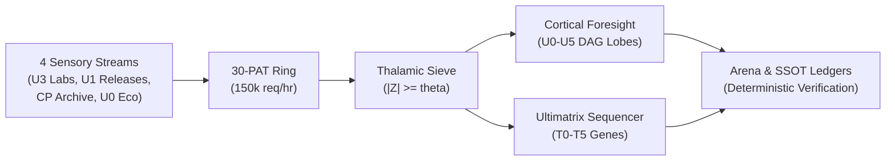

# Azmuth Neuromorphic Command Center — Operator Manual and Technical Reference

The Azmuth Neuromorphic Command Center is a native, zero-dependency Win32 desktop application that visualizes and controls the end-to-end telemetry, causal macro-graphs, and genetic mutation pipelines of the Azmuth Foresight Core with sub-15 MB RAM overhead at 60 frames per second.

---

## 1. Architectural Scope & Operating Principles

The command center interfaces directly with the Azmuth Foresight & Ultimatrix subsystems (`azmuth_macro_graph.py`, `azmuth_github_sensor.py`, `ultimatrix_arena.py`). It coordinates three primary operational domains:

1. **Sensory Radar & PAT Allocation**: Ingestion of GitHub activity across 4 sensory streams, routed through an asymmetric 30-token pooled key ring and filtered via a Thalamic $|Z|$-score salience sieve.
2. **Neuromorphic Causal Foresight**: Spiking neural activation dynamics across 6 swappable cortical cartridges (`U0` through `U5`), tracking lag days, synaptic weights, and multi-hop shock propagation (+2.0$\sigma$).
3. **Phylogenetic Gene Evolution**: Algorithmic evolution across 349+ competitive programming DNA loci, linking wild-type baselines to mutator operators (`+pragma_tuning`, `+bitwise_unrolling`, `+static_memory`, `+fast_io`) and evaluating runtime/memory fitness in the Ultimatrix Arena.



---

## 2. Workspace Anatomy

The workspace is organized into four ergonomic, DPI-scaled regions designed to avoid visual clutter and maintain a minimum 50% screen width allocation for the central canvas:

```
+----------------------------------------------------------------------------------------------------+
| TOP TELEMETRY BAR: Daemon Gear | 60FPS RAM Oscilloscope | Quota Pool | KPI Cards | Zoom | Theme   |
+------------------------------------+-----------------------------------------------+---------------+
| LEFT NAVIGATION PANEL              | CENTRAL INTERACTIVE VECTOR CANVAS             | RIGHT PANEL   |
| - Stream & Cartridge Selector      | - Infinite Virtual Camera (Pan/Zoom)          | - Capability  |
| - Tier Filter Pills (T0-T5)        | - World-Space Drag & Drop Node Manipulation   |   Inspector   |
| - Instant Fuzzy Search Filter      | - Auto-Fit Text Bounding (SVG Vector Bounds)  | - Code Diff   |
|                                    | - Dynamic Multi-Column Operator Lanes         |   Viewer      |
+------------------------------------+-----------------------------------------------+---------------+
| STATUS FOOTER: Event Loop Status (60 FPS) | Active Subsystem | Viewport Zoom Indicator             |
+----------------------------------------------------------------------------------------------------+
```

### Region 1: Top Telemetry Bar
- **Daemon Gear Selector**: Switch operating speeds between `Whisper` (0.10x power), `Balanced` (1.0x power), and `Turbo` (2.5x burst).
- **RAM Oscilloscope & Circuit Breaker**: Real-time 60FPS sparkline tracking system memory. A red dashed threshold indicates the hardware circuit breaker limit. If free RAM falls below this limit, operations are throttled to prevent OS memory exhaustion.
- **PAT Token Pool Counter**: Displays live counts of ready, cooldown, and rate-limited GitHub Personal Access Tokens.
- **KPI Badges**: Track active gene loci, cumulative mutations applied, and total tournament races executed.
- **Zoom Ladder & Theme Controls**: Provides instant magnification adjustment (`70%` to `225%`) and Dark/Light palette toggling.

### Region 2: Left Navigation Panel (Clamped $\le 22\%$ Window Width)
- Displays filterable entity hierarchies matching the active view:
  - **View 1**: Monitored repositories, token accounts, and actionable lab issues.
  - **View 2**: Available cortical cartridges (`U0` through `U5`) and individual causal nodes.
  - **View 3**: Complete genomic taxonomy with instant search by gene name, category, or algorithm complexity, filtered by tier pills (`T0` through `T5`).

### Region 3: Central Interactive Vector Canvas (Allocated $\ge 50\%$ Window Width)
- Renders high-precision vector schematics with float-to-screen coordinate transforms.
- Connects stages using cubic Bezier splines with direction arrows and contrast-backed metadata pill badges.
- Automatically adjusts card dimensions using font measurement (`tkFont.measure()`), guaranteeing zero text truncation or border clipping.

### Region 4: Right Capability & Code Diff Inspector (Clamped $\le 28\%$ Window Width)
- Details the currently selected node or pipeline stage:
  - Big-O asymptotic time and space bounds.
  - Environmental execution constraints and triggers.
  - Mathematical and formal algorithmic invariants.
  - Empirical fitness comparison bars (`runtime_ms` and `ram_kb`).
  - Syntax-highlighted C++/Python source code templates with diff styling for mutation injections.

---

## 3. Interactive Canvas Operations

The canvas utilizes a continuous virtual coordinate plane (World Coordinates) decoupled from physical window resolution:

| Action | Input Binding | Operational Behavior |
| :--- | :--- | :--- |
| **Move Node** | Left-Click & Drag on Node | Relocates the selected node in World Space. All connecting Bezier curves update continuously in real time. Custom positions persist across view switches. |
| **Pan Canvas** | Left-Click & Drag on Canvas Background<br>Middle-Click Drag<br>Right-Click Drag | Translates the virtual camera viewport (`cam_x`, `cam_y`). World coordinates remain fixed. |
| **Zoom Viewport** | Cursor-Centered MouseWheel<br>`Ctrl + =` / `Ctrl + +`<br>`Ctrl + -` / `Ctrl + _` | Magnifies or shrinks the canvas between 40% and 300%. The world position directly beneath the cursor remains stationary during zooming. |
| **Inspect Node** | Left-Click (without drag) | Selects the node, draws a dashed accent outline, and populates the Right Inspector with telemetry, invariants, and source code. |
| **Reset Layout** | `↺ Reset Layout` Button<br>`Ctrl + 0` / `Ctrl + Numpad 0` | Clears all manual node drag offsets, resets the camera to default center `(640.0, 380.0)`, and restores 100% zoom. |
| **Toggle Theme** | `Ctrl + T`<br>Header Theme Button | Switches between Dark Mode (`#090b0e`) and Light Mode (`#f8fafc`), synchronizing the Windows 11 DWM titlebar via `DwmSetWindowAttribute`. |

---

## 4. Operational View Workflows

### View [1]: End-to-End Pipeline & PAT Sensory Flow
- **Purpose**: Monitor sensory ingestion, token pool health, and thalamic gating.
- **Workflow**:
  1. Inspect the 4 input sensory streams (`U3 Labs`, `U1 Releases`, `Codon CP`, `U0 Eco`).
  2. Verify the 30-PAT Ring status. Pulsing dots indicate active key utilization; amber dots denote accounts under rate-limit cooldown.
  3. Adjust the **Thalamic $|Z|$-Score Gate** spinner in the top bar ($0.5\sigma$ to $2.5\sigma$) to filter out background noise.
  4. Click `STAGE_THALAMIC` to inspect all qualifying opportunities exceeding the salience threshold.

### View [2]: U0–U5 Neuromorphic Causal DAG
- **Purpose**: Evaluate causal dependencies, homeostatic balance, and shock propagation across cortical lobes.
- **Workflow**:
  1. Select a cartridge from the Left Panel (`U0 Macro`, `U1 SOTA`, `U2 CP`, `U3 Edge`, `U4 Symbolic`, `U5 Meta`).
  2. Node colors indicate homeostatic health:
     - **Cyan** ($|Z| < 2.0\sigma$): Stable nominal baseline.
     - **Amber** ($2.0\sigma \le |Z| < 3.0\sigma$): Elevated volatility warning.
     - **Crimson** ($|Z| \ge 3.0\sigma$): Critical spike requiring intervention.
  3. Click **`⚡ Shock (+2.0σ)`** in the Inspector to inject an adversarial shock wave and observe multi-hop ripple propagation across downstream nodes.

### View [3]: Phylogenetic Gene Evolution Tree & Allele Arena
- **Purpose**: Trace genetic lineage, evaluate empirical fitness, and synthesize daughter alleles.
- **Workflow**:
  1. Filter by tier pills (`T0` Primitives to `T5` Super-Domain) or enter an algorithmic query in the search bar.
  2. Select a gene locus (e.g., `TASK_ADDITION`).
  3. The canvas renders the lineage across dedicated horizontal lanes:
     - **Locus Root** (`x = 240`): Primary genomic contract and complexity bounds.
     - **Wild-Type Baselines** (`x = 640`): Verified baseline implementations.
     - **Parallel Operator Lanes** (`x = 1040, 1420, 1800`): Mutated daughter alleles grouped cleanly by mutation operator (`+pragma_tuning`, `+bitwise_unrolling`, `+static_memory`, `+fast_io`), preventing vertical card stacking.
  4. Click **`▶ Mutate & Race`** in the action bar to dispatch background genetic mutation and arena tournament benchmarking.

---

## 5. Scope Boundaries & Non-Goals

1. **Native OS Process**: Operates strictly as a local Win32 Tkinter process using standard C runtime hooks. It does not embed web runtime engines (Chromium Embedded Framework, Electron, or WebView2), ensuring memory consumption remains bounded below 25 MB under all workloads.
2. **Deterministic Layout Math**: Node positions are computed via explicit geometric projection matrices rather than nondeterministic force-directed spring simulations, ensuring instantaneous layout loads with zero layout jitter.
3. **Session Persistence**: Manual node drag adjustments are retained in memory for the duration of the active desktop session. They do not overwrite underlying immutable capability contracts on disk. Clicking `↺ Reset Layout` restores the default algorithmic layout.

---

## 6. Verification & Health Audit

The command center test suite validates DPI scaling, theme transitions, node dragging math, layout reset mechanisms, and multi-lane phylogeny grouping:

```powershell
# Run the Azmuth GUI test suite
pytest tests/test_azmuth_gui.py -v

# Run the Fleet GUI compatibility suite
pytest tests/test_fleet_gui.py -v
```
