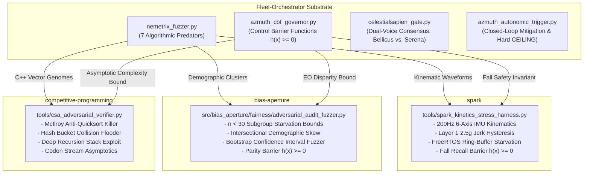

# Ecosystem Projection Matrix: Public vs. Private Key Architecture

This dossier documents the **Domain-Calibrated Outward Projection Architecture** connecting the central invariance engine in `Fleet-Orchestrator` to specialized target repositories across the ecosystem.

---

## 1. Core Paradigm: Public vs. Private Key Analogy

---

## 2. Projection Register

| Repository | Canonical Name | Target Path | Projected Tool Name | Domain Adaptation ("Public Interface") | Status & Verification |
| :--- | :--- | :--- | :--- | :--- | :--- |
| **SPARK** | `spark` | `F:\Aaradhya-Dev-Tamrakar\SPARK` | [`tools/spark_kinetics_stress_harness.py`](file:///F:/Aaradhya-Dev-Tamrakar/SPARK/tools/spark_kinetics_stress_harness.py) | FreeRTOS task queues, 200Hz IMU streams, $2.5g$ trigger hysteresis, fall recall barrier $h(x) = \text{recall} - 0.95 \ge 0$. | **Merged & PR Opened**: PR [#16](https://github.com/Aaradhya-Dev-Tamrakar/SPARK/pull/16) (4/4 tests pass). |
| **BiasAperture** | `bias-aperture` | `F:\Aaradhya-Dev-Tamrakar\BiasAperture` | [`src/bias_aperture/fairness/adversarial_audit_fuzzer.py`](file:///F:/Aaradhya-Dev-Tamrakar/BiasAperture/src/bias_aperture/fairness/adversarial_audit_fuzzer.py) | Subgroup sample starvation ($n < 30$), intersectional skew generation, demographic parity barrier $h(x) = \text{max\_gap} - \text{gap} \ge 0$. | **Merged into main**: PR [#62](https://github.com/fuseai-fellowship/BiasAperture-A-Diagnostic-Framework-for-Demographic-Bias-Auditing-in-Facial-Analysis-Models/pull/62) ([`5ead0f8`](https://github.com/fuseai-fellowship/BiasAperture-A-Diagnostic-Framework-for-Demographic-Bias-Auditing-in-Facial-Analysis-Models/commit/5ead0f8)). |
| **Competitive-Programming** | `competitive-programming` | `F:\Aaradhya-Dev-Tamrakar\Competitive-Programming` | [`tools/csa_adversarial_verifier.py`](file:///F:/Aaradhya-Dev-Tamrakar/Competitive-Programming/tools/csa_adversarial_verifier.py) | McIlroy anti-quicksort $O(N^2)$ killer sequences, power-of-two hash collision flooders, codon stream gene verifiers. | **Merged into main**: Issue [#8](https://github.com/Aaradhya-Dev-Tamrakar/Competitive-Programming/issues/8) ([`4c6d51a`](https://github.com/Aaradhya-Dev-Tamrakar/Competitive-Programming/commit/4c6d51a)). |

---

## 3. Autonomic Closed-Loop Governance

In `Fleet-Orchestrator`, the autonomous loop is governed by:
- **`azmuth_cbf_governor.py`**: Computes barrier $h(x)$ across all 81 nodes.
- **`celestialsapien_gate.py`**: Enforces unanimous consensus between Bellicus (skeptic) and Serena (harmony) before high-stakes operations.
- **`azmuth_autonomic_trigger.py`**: Automatically triggers mitigation when $h(x) < 0.20$, strictly bounding compute unit spend ($>50\text{ CU}$ reserve floor, sub-30s session teardown).
