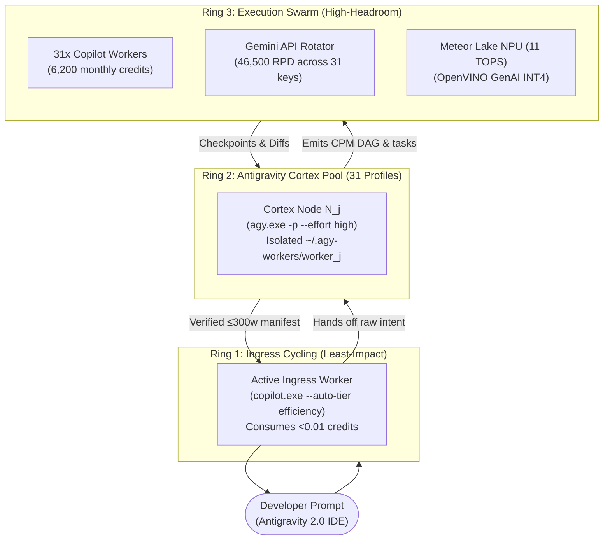

# RFC-001: 31-Node Homogeneous Tri-Modal Swarm Mesh

**Status:** PROPOSED  
**Priority:** HIGH  
**Author:** Aaradhya Dev Tamrakar  
**Date:** 2026-10-11  
**Origin:** [Antigravity Conversation fd484a9b](conversation://fd484a9b-9442-45c6-934c-c949bbbfecb1)  
**Tracking Issue:** [GitHub Issue #26](https://github.com/AaradhyaDT/Fleet-Orchestrator/issues/26)

---

## 1. Abstract

Evolve Fleet-Orchestrator from an asymmetric orchestration engine (single user → batch workers) into a **31-node homogeneous peer mesh** where every account is a polymorphic tri-modal node possessing:

1. **Antigravity CLI** (`agy.exe -p`) — cognitive cortex & deep reasoning
2. **Gemini API Key** — zero-credit fast-path acceleration (formatting, AST, lint)
3. **GitHub Copilot CLI** (`copilot.exe --autopilot`) — code generation muscle

A **double round-robin quota cycling** engine distributes both interactive steering and background execution across the entire pool, eliminating single-account choke points.

---

## 2. Motivation & Problem Statement

### Current Limitations
- **Single-account ingress bottleneck**: Interactive chat consumes quota from one primary account while 26 others sit idle.
- **Asymmetric burn**: Copilot credits drain unevenly; primary account exhausts monthly quota while the pool has >5,000 unused credits.
- **Manual batch dispatch**: Fleet Commander requires explicit CLI invocations to distribute work — no autonomous cycling.
- **Cognitive-execution coupling**: The same session that reasons about architecture also burns credits on code generation.

### Target State
Every node $N_i$ ($i \in \{1 \dots 31\}$) dynamically assumes one of three transient roles:
- **Ingress** (conversational steering, <0.01 credits)
- **Cortex** (architectural planning via Antigravity, $0 Copilot credits)
- **Muscle** (headless code generation in isolated `.worktrees/`)

---

## 3. Architecture

### 3.1 Aggregate Fleet Capacity

$$\text{Total Fleet} = 31 \times \begin{pmatrix} \text{Antigravity Cortex (2M Context)} \\ 1{,}500\text{ Gemini RPD} / 15\text{ RPM} \\ 200\text{ Copilot AI Credits/month} \end{pmatrix}$$

| Modality | Per Node | 31-Node Pool | Role in Triad |
|:---|:---|:---|:---|
| **Antigravity CLI** | Isolated profile sandbox | **31 concurrent cortexes** | Deep reasoning, DAG planning, invariant auditing |
| **Gemini API** | 1,500 RPD / 15 RPM | **46,500 RPD / 465 RPM** | Zero-credit fast paths, JSON/AST validation, lint |
| **Copilot CLI** | 200 credits/month | **6,200 credits/month** | Multi-file code generation in `.worktrees/` |

### 3.2 Tri-Ring Topology

### 3.3 Double Round-Robin Quota Cycling

**Ring 1 (Outer — Ingress):** Rotates the interactive conversational identity through least-impact accounts. If account $k$ triggers a 429 burst limit, the rotator immediately fails over to account $k+1$.

**Ring 2 (Inner — Execution):** The `QuotaAwareScheduler` scores workers via:

$$\text{Score}(W) = w_1 \cdot \text{Pref} + w_2 \cdot \text{QuotaHead} - w_3 \cdot \text{Active} + w_4 \cdot \text{ProviderTier}$$

Workers with highest remaining quota headroom are preferred, achieving symmetric pool drainage across all 31 accounts.

### 3.4 Single GUI Principle

- **User-facing GUI**: Antigravity 2.0 IDE (this application) — full 2M-token context, interactive artifacts, KaTeX, subagents, deep reasoning.
- **All workers headless CLI**: `agy.exe -p`, `copilot.exe --autopilot`, Gemini API async — zero windows, zero focus stealing, ~15-30 MB RAM per worker.
- **Active subprocess throttle**: Max 4–6 concurrent local processes to respect Meteor Lake hardware envelope (Core Ultra 7 155H, 32 GB RAM).

---

## 4. Tri-Portal Ingress Model

| Portal | Use Case | Quota Cost |
|:---|:---|:---|
| **Antigravity 2.0 IDE** | Macro strategy: architecture, `/plan`, research dossiers, multi-file DAG orchestration | $0 Copilot (Gemini auth) |
| **Antigravity CLI (`agy`)** | Terminal fast agency: `agy -i`, `agy -p`, profile rotation across 31 sandboxes | $0 Copilot (Gemini auth) |
| **VS Code Copilot Chat (`@fleet`)** | In-editor micro flow: line-selection refactors, quick dispatches | Least-impact ingress cycling |

---

## 5. Implementation Components

### Component 1: Fleet Configuration Expansion (27 → 31 Accounts)

| File | Change |
|:---|:---|
| `.env.fleet.copilot` | Add `COPILOT_ACCOUNT_28` through `COPILOT_ACCOUNT_31` |
| `.env.fleet.gemini` | Populate `GEMINI_API_KEY_1` through `GEMINI_API_KEY_31` (separate GCP projects) |
| `.env.fleet.agy` | Expand `AGY_WORKER_1` through `AGY_WORKER_31` with isolated `~/.agy-workers/worker_N` homes |

### Component 2: VS Code `@fleet` Chat Participant

- Register `chatParticipants` in `extensions/vscode-fleet-companion/package.json`
- Implement `vscode.chat.createChatParticipant("fleet-swarm", handler)` in `extension.js`
- Commands: `/plan`, `/submit`, `/status`
- Language Model Tools: `fleet_antigravity_think`, `fleet_submit_task`, `fleet_get_quota`

### Component 3: Antigravity Cognitive MCP Tool

- Add `antigravity_think` tool to `server/mcp_remote.py`
- Integrates with `client/adapters/agy_adapter.py` for headless cortex reasoning
- Returns structured CPM DAG + implementation plan

### Component 4: Terminal Ingress & AGY CLI Rotator

- `tools/agy_rotator.py` — round-robin profile selector with cooldown detection
- `fleet.bat agy "prompt"` — dispatches to next healthy AGY profile
- `fleet.bat agy-chat` — launches interactive `agy` shell with isolated fleet profile

---

## 6. Key Invariants

1. **Subprocess Isolation (`INV-PROC-ISO`)**: Every worker receives its own `COPILOT_GITHUB_TOKEN`, `COPILOT_HOME`, and `AGY_WORKER_HOME`. Zero shared credentials.
2. **Context Firebreak (`INV-CTX-FIREBREAK`)**: Parent chat context stays <5,000 tokens. Batch workloads delegate to Fleet Commander subagents.
3. **Externalized State (`INV-EXT-STATE`)**: Because ingress accounts cycle, session state lives in `orchestrator-state/tasks/` and Antigravity's transcript — never in transient process memory.
4. **Hardware Throttle (`INV-HW-THROTTLE`)**: Active local subprocess concurrency capped at 4–6 workers via `QuotaAwareScheduler`, regardless of 31-account pool size.
5. **Zero Credential Commits (`INV-ZERO-CRED`)**: `.env.fleet.*` files are `.gitignore`d. Only `.example` templates are tracked.

---

## 7. Economic Model

### Credit Preservation via Asymmetric Cost Allocation

| Action | Token Cost | Absorbing Layer | Impact on 6,200/mo Pool |
|:---|:---|:---|:---|
| Interactive steering | <500 tokens | Copilot Ingress (least-impact) | **Negligible** (~0.01 credits) |
| Architectural planning | 10k–100k tokens | Antigravity Cortex | **$0** (Gemini auth) |
| JSON/lint validation | 1k–5k tokens | Gemini API Rotator | **$0** (46,500 RPD pool) |
| Multi-file code gen | 5k–50k tokens | Copilot Fleet Workers | **1–30 credits** per task |

**Result**: The 6,200 monthly Copilot credits are preserved almost entirely for raw code generation. Planning and validation consume zero Copilot quota.

---

## 8. Failure Modes & Guardrails

| Hazard | Guardrail |
|:---|:---|
| **Multi-hop latency** (Copilot→AGY→Fleet→Verify: 5–15s) | Tier 0 Fast Path: simple 1-line queries answered directly without waking cortex or fleet |
| **Context fragmentation** across rotating ingress accounts | Antigravity transcript + `orchestrator-state/tasks/` as external source of truth |
| **Hardware saturation** (31 concurrent subprocesses) | Active concurrency throttled to 4–6 workers via scheduler |
| **Single Gemini project quota** (15 RPM shared) | Each key from separate GCP project — true multiplied capacity |

---

## 9. Verification Criteria

- [ ] `python tools/fleet_env.py` discovers all 31 accounts across all 3 fleet env files
- [ ] `python tools/unified_fleet_cli.py status` reports 6,200 monthly Copilot credits, 31 Gemini keys
- [ ] `pytest tests/` maintains 100% pass rate (≥195 tests)
- [ ] VS Code `@fleet /status` renders live telemetry in chat sidebar
- [ ] `fleet.bat agy "test prompt"` successfully rotates to healthy AGY profile
- [ ] `antigravity_think` MCP tool returns structured DAG from `mcp_remote.py`
- [ ] Credit ledger correctly tracks per-worker usage across 31 accounts
- [ ] No `.env.fleet.*` secrets committed (only `.example` templates)

---

## 10. References

- [Fleet-Orchestrator SKILL.md](../../../.agents/skills/fleet-orchestrator/SKILL.md)
- [Adaptive Workflow SKILL.md](../../../.agents/skills/adaptive-workflow/SKILL.md)
- [Antigravity Bridge](../../client/antigravity_bridge.py)
- [QuotaAwareScheduler](../../server/core/scheduler.py)
- [Gemini Key Rotator](../../client/adapters/gemini_fleet_rotator.py)
- [Credit Ledger](../../tools/credit_ledger.py)
- [AGY CLI Adapter](../../client/adapters/agy_adapter.py)
- [Copilot CLI Adapter](../../client/adapters/copilot_cli_adapter.py)
